## 1. Genel Bakış

### 1.1. Projenin Amacı ve Kapsamı
**Randevu Ekosistemi**, güzellik merkezleri, kuaförler, berberler, klinikler, oto servisleri ve benzeri yerel hizmet sağlayıcıları ile son kullanıcıları tek bir dijital platformda buluşturan yeni nesil bir randevu ve rezervasyon yönetim sistemidir. Sistem; dinamik takvim yönetimi, personel bazlı randevu slotlama, anlık slot kilitleri (çift rezervasyon koruması), iyzico üzerinden kapora/ön ödeme güvencesi, Firebase Cloud Messaging (FCM) push bildirimleri ve SMS (Netgsm) OTP doğrulamasını uçtan uca yöneten bir arka uç altyapısı sunmaktadır.

*Kaynak:* `src/main/resources/application.yml`, `README.md`, `src/main/java/com/yunus/RandevuApplication.java`

### 1.2. Modüler Monolith Yapısı
Proje, mikroservislerin getirdiği dağıtık ağ yükü, karmaşık operasyonel maliyetler ve veri tutarlılığı risklerinden kaçınmak amacıyla **Modüler Monolith (Modular Monolith)** mimarisinde tasarlanmıştır. Tüm işlevler tek bir Spring Boot yürütülebilir JAR paketi içerisinde barındırılmakta; ancak kod organizasyonu bağımsız iş etki alanlarına (domain modules) göre paket bazında katı bir şekilde ayrıştırılmıştır.

Modüller veritabanı seviyesinde ortak bir PostgreSQL şemasını paylaşmakla birlikte, Java uygulama katmanında her modül kendi entity, repository, service, controller ve DTO yapılarına sahiptir.

### 1.3. Modüllerin Listesi ve Sorumlulukları
Projede `src/main/java/com/yunus/` dizini altında yer alan 16 ana modül/paket bulunmaktadır:

| Modül / Paket | Sorumluluk ve İşlev Özeti | Temel Kaynak Dizini |
| :--- | :--- | :--- |
| **appointment** | Randevu oluşturma, yaşam döngüsü durum geçişleri (onay, iptal, tamamlama, no-show), slot arama ve hesaplama algoritmaları, Redis dağıtık slot kilidi yönetimi. | `src/main/java/com/yunus/appointment` |
| **auth** | Kullanıcı kayıt ve giriş akışları, JWT access token üretimi, SHA-256 hash'li veritabanı refresh token yönetimi/rotasyonu, token iptali (logout) ve admin kullanıcı yönetimi. | `src/main/java/com/yunus/auth` |
| **business** | İşletme profili, işletme kategorileri, hizmet kataloğu (services), çalışan/personel yönetimi (staff), haftalık çalışma saatleri, tatil/izin günleri, işletme fotoğrafları, keşfet/arama ve işletme sahiplik doğrulama mantığı. | `src/main/java/com/yunus/business` |
| **user** | Kullanıcı profili görüntüleme ve güncelleme, şifre değiştirme, Netgsm SMS ile telefon doğrulama (OTP) ve kullanıcı yetki rolleri. | `src/main/java/com/yunus/user` |
| **payment** | iyzico 3D Secure ödeme başlatma, banka callback işleme, callback idempotency kontrolü, kapora ve tam ödeme takibi, iade (refund) işlemleri. | `src/main/java/com/yunus/payment` |
| **review** | Tamamlanmış randevular sonrası müşteri değerlendirmeleri ve 1-5 yıldız puanlaması, işletme ortalama puan hesaplama ve admin inceleme moderasyonu. | `src/main/java/com/yunus/review` |
| **location** | İl (City), İlçe (District) ve Mahalle (Neighborhood) hiyerarşik coğrafi veri yönetimi ve adres filtreleme altyapısı. | `src/main/java/com/yunus/location` |
| **notification** | Firebase Cloud Messaging (FCM) entegrasyonu, mobil cihaz FCM token kaydı, randevu onay/iptal anlık push bildirimleri ve 15 dakikalık zamanlanmış hatırlatıcılar. | `src/main/java/com/yunus/notification` |
| **sms** | Netgsm SMS API entegrasyonu, OTP (tek kullanımlık şifre) üretimi, Redis üzerinde TTL ile saklama ve deneme sayısı takibi. | `src/main/java/com/yunus/sms` |
| **storage** | AWS S3 uyumlu Cloudflare R2 nesne depolama entegrasyonu; işletme cover/galeri fotoğrafları ve hizmet görsellerinin UUID ile yüklenmesi/silinmesi. | `src/main/java/com/yunus/storage` |
| **ratelimit** | Redis Sorted Set (ZSET) sliding window algoritması ile kritik endpoint'lerde IP veya Kullanıcı bazlı istek sınırlandırma (@RateLimit interceptor). | `src/main/java/com/yunus/ratelimit` |
| **security** | Spring Security filtre zinciri, stateless JWT doğrulaması, UserPrincipal nesnesi, CurrentUserService (oturum bağlamı) ve Redis token blacklist yönetimi. | `src/main/java/com/yunus/security` |
| **common** | Ortak JPA BaseEntity (UUID id, created_at, updated_at), standart API BaseResponse zarfı ve ortak exception sınıfları. | `src/main/java/com/yunus/common` |
| **config** | Güvenlik, CORS, Redis, S3, Firebase, MVC interceptor ve thread pool (TaskExecutor) Spring bean konfigürasyonları. | `src/main/java/com/yunus/config` |
| **exception** | GlobalExceptionHandler (@RestControllerAdvice), ErrorResponse hata modeli ve HTTP durum eşlemeli ErrorType enum yapısı. | `src/main/java/com/yunus/exception` |
| **webhook** | Dış otomasyon sistemlerine (n8n vb.) asenkron olay bildirimleri (webhook events) fırlatma altyapısı. | `src/main/java/com/yunus/webhook` |

### 1.4. Modüller Arası Bağımlılıklar
Modüller arası ilişkiler servis enjeksiyonları ve entity yabancı anahtarları (foreign keys) üzerinden yürütülmektedir:
- `appointment` modülü; randevu oluşturulurken `business` (işletme ve personel varlığı), `user` (müşteri), `notification` (onay/iptal push bildirimi), `ratelimit` (istek sınırlama) ve `security` (oturum açan kullanıcı) bileşenlerine bağımlıdır.
- `payment` modülü; ödeme başlatma ve tamamlama sırasında `appointment` ve `user` modüllerine bağımlıdır.
- `review` modülü; değerlendirmenin yalnızca tamamlanmış randevuya ait olduğunu doğrulamak için `appointment`, `business` ve `user` modüllerini kullanır.
- `business` modülü; işletme görselleri için `storage` servisini, adres ilişkileri için `location` modülünü kullanır.

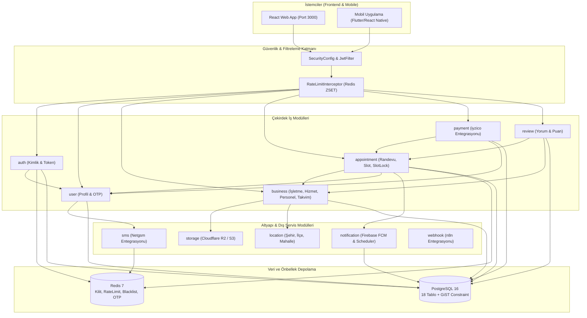

---

## 2. Teknoloji Yığını (Technology Stack)

### 2.1. pom.xml Bağımlılıkları ve Sürümleri
Proje, Apache Maven derleme aracı ile yönetilmektedir. Bağımlılıkların ve sürümlerinin doğrudan `pom.xml` dosyasından derlenen listesi aşağıdadır:

| Kategori / Bileşen | Kütüphane / Artifact | Sürüm | Açıklama / Kaynak |
| :--- | :--- | :--- | :--- |
| **Java Platformu** | OpenJDK / Temurin | `21` | `<java.version>21</java.version>`, `maven-compiler-plugin:3.14.1` (`release 21`) |
| **Ana Framework** | Spring Boot Parent | `4.0.6` | `org.springframework.boot:spring-boot-starter-parent:4.0.6` |
| **Web MVC** | Spring Web MVC | `4.0.6` | `spring-boot-starter-webmvc` |
| **Güvenlik** | Spring Security | `4.0.6` | `spring-boot-starter-security` |
| **Veri Tabanı ORM** | Spring Data JPA | `4.0.6` | `spring-boot-starter-data-jpa` (Hibernate ORM `7.2.12.Final`) |
| **Veri Tabanı Sürücüsü** | PostgreSQL JDBC Driver | Runtime | `org.postgresql:postgresql` |
| **Veri Tabanı Migration**| Flyway Migration | `4.0.6` | `spring-boot-starter-flyway`, `flyway-database-postgresql` |
| **Önbellek & Kilit** | Spring Data Redis | `4.0.6` | `spring-boot-starter-data-redis` (Lettuce sürücüsü) |
| **JWT Kütüphanesi** | io.jsonwebtoken (JJWT) | `0.12.6` | `jjwt-api`, `jjwt-impl`, `jjwt-jackson` (HS256) |
| **Bulut Depolama** | AWS SDK for Java (S3) | `2.31.1` | `software.amazon.awssdk:s3:2.31.1` (Cloudflare R2 uyumlu) |
| **Ödeme Sağlayıcı** | iyzico Java SDK | `2.0.61` | `com.iyzipay:iyzipay-java:2.0.61` |
| **XML / JAXB Desteği**| GlassFish JAXB API | `2.3.1` | `javax.xml.bind:jaxb-api:2.3.1` (iyzipay Java 11+ uyumu için) |
| **Push Bildirim** | Firebase Admin SDK | `9.3.0` | `com.google.firebase:firebase-admin:9.3.0` |
| **Dokümantasyon** | SpringDoc OpenAPI UI | `2.8.6` | `springdoc-openapi-starter-webmvc-ui:2.8.6` (Swagger) |
| **Validasyon** | Bean Validation | `4.0.6` | `spring-boot-starter-validation` (Hibernate Validator) |
| **Kod Üretici** | Project Lombok | Managed | `org.projectlombok:lombok` (Getter, Setter, RequiredArgsConstructor) |
| **DTO Eşleme (MapStruct)** | *Bulunamadı* | - | `pom.xml` içerisinde MapStruct tanımlı değildir. DTO dönüşümleri manuel assembler / builder metotları ile yapılmaktadır. |
| **Test Framework** | Spring Boot Test | `4.0.6` | `spring-boot-starter-test` (JUnit 5 Jupiter, Mockito, AssertJ) |
| **Güvenlik Testi** | Spring Security Test | `4.0.6` | `org.springframework.security:spring-security-test` |
| **Eşzamanlılık Testleri**| Testcontainers | `1.20.4` | `org.testcontainers:junit-jupiter`, `postgresql`, `spring-boot-testcontainers` |

*Kaynak Dosya:* `pom.xml`

### 2.2. docker-compose Servisleri ve İmaj Sürümleri
Konteyner ortamı `docker-compose.yml` dosyasında 3 ana servis olarak yapılandırılmıştır:

```yaml
# docker-compose.yml Özeti
version: '3.8'

services:
  postgres:
    image: postgres:16-alpine
    container_name: randevu-db
    ports: ["5432:5432"]
    volumes: [pgdata:/var/lib/postgresql/data]
    environment:
      POSTGRES_DB: ${POSTGRES_DB}
      POSTGRES_USER: ${POSTGRES_USER}
      POSTGRES_PASSWORD: ${POSTGRES_PASSWORD}

  redis:
    image: redis:7-alpine
    container_name: randevu-redis
    ports: ["6379:6379"]

  app:
    build:
      context: .
      dockerfile: Dockerfile
    container_name: randevu-app
    ports: ["8080:8080"]
    environment:
      - SPRING_PROFILES_ACTIVE=dev
      - DB_URL=jdbc:postgresql://postgres:5432/postgre_db
      - DB_USERNAME=${DB_USERNAME:-postgres}
      - DB_PASSWORD=${DB_PASSWORD}
      - REDIS_HOST=redis
      - REDIS_PORT=6379
      - JWT_SECRET=${JWT_SECRET}
    depends_on: [postgres, redis]
```

*Kaynak Dosya:* `docker-compose.yml`

### 2.3. Uygulama Profilleri (Profiles)
Projede 3 farklı Spring çalışma profili tanımlanmıştır:

1. **`dev` (Geliştirme Profili - Varsayılan):**
   - Kaynak: `src/main/resources/application-dev.yml`
   - Port: `8080`
   - Hibernate DDL Modu: `ddl-auto: validate`
   - Flyway: `enabled: true`, `baseline-on-migrate: true`, `baseline-version: 0`
   - HikariCP Havuz: `maximum-pool-size: 10`, `minimum-idle: 5`
   - SQL Gösterimi: `show-sql: true`, `format_sql: true`
   - Swagger / OpenAPI: `enabled: true`
   - Redis Kara Liste Hatası: `fail-on-redis-blacklist-error: false` (Redis kesintisinde sistem çökmez, graceful degradation uygulanır)
   - CORS İzinleri: `http://localhost:3000`, `http://localhost:5173`, `http://localhost:8081`, `http://localhost:8082`, `http://localhost:8084`
   - İşletme Onayı: `app.business.auto-approve: true`

2. **`prod` (Canlı Ortam Profili):**
   - Kaynak: `src/main/resources/application-prod.yml`
   - Port: `${SERVER_PORT:8080}`
   - Hibernate DDL Modu: `ddl-auto: validate`
   - Flyway: `enabled: true`, `baseline-on-migrate: false` (temiz başlangıç şart koşulur)
   - HikariCP Havuz: `maximum-pool-size: ${DB_POOL_MAX:20}`, `minimum-idle: ${DB_POOL_MIN:5}`
   - SQL Gösterimi: `show-sql: false`
   - Swagger / OpenAPI: `enabled: false` (Güvenlik gereği dokümantasyon dışa kapalıdır)
   - Redis Kara Liste Hatası: `fail-on-redis-blacklist-error: true` (Redis erişilemezse güvenlik için token geçersiz sayılır)
   - CORS İzinleri: `${CORS_ALLOWED_ORIGINS:https://randevu.example.com}`

3. **`test` (Otomasyon Test Profili):**
   - Kaynak: `src/main/resources/application-test.yml`
   - DDL: `ddl-auto: validate`
   - Flyway: `enabled: true`, `baseline-on-migrate: true`
   - Swagger: `enabled: false`
   - Sabit test JWT anahtarı ve test R2 bucket parametreleri kullanılır.

---

## 3. Roller ve Yetkilendirme (RBAC & Security)

### 3.1. Tanımlı 4 Rol ve Sorumlulukları
Sistemdeki tüm roller `com.yunus.user.entity.UserRole` enum'ı altında tanımlanmıştır:

1. **`USER` (Müşteri / Son Kullanıcı):**
   - Dilediği kategorideki onaylı işletmeleri ve hizmetleri listeleyebilir (`/api/v1/discover/**`).
   - Müsait takvim slotlarını sorgulayabilir (`/api/v1/appointments/available-slots`).
   - Kendisi adına randevu oluşturabilir (`POST /api/v1/appointments`).
   - Kendi randevularını listeleyebilir ve dilediği randevuyu iptal edebilir (`PATCH /api/v1/appointments/{id}/cancel-by-user`).
   - Tamamlanan randevusu için 1-5 yıldız aralığında yorum ve puan ekleyebilir (`POST /api/v1/reviews`).
   - Kendi profil bilgilerini güncelleyebilir, şifre değiştirebilir ve telefonuna SMS OTP kodu isteyerek telefonunu doğrulayabilir (`/api/v1/users/me/**`).
   - Randevusu için iyzico üzerinden kapora veya tam ödeme başlatabilir (`POST /api/v1/payments/initiate`).

2. **`BUSINESS_OWNER` (İşletme Sahibi):**
   - Yeni bir işletme kaydı oluşturabilir (`POST /api/v1/businesses`).
   - Sahibi olduğu işletmenin adres, telefon, unvan, açıklama bilgilerini güncelleyebilir.
   - İşletmeye ait hizmet kataloğunu (`services`), çalışan personelleri (`staff`), haftalık çalışma saatlerini (`working-hours`), tatil günlerini (`holidays`) ve galeri fotoğraflarını (`photos`) tam yetkiyle yönetebilir.
   - İşletmesine gelen tüm randevuları tarih bazlı listeleyebilir (`/api/v1/appointments/business/{businessId}`).
   - Randevuları onaylayabilir (`confirm`), işletme adına iptal edebilir (`cancel-by-business`), tamamlandı (`complete`) veya gelinmedi (`no-show`) olarak işaretleyebilir.

3. **`BUSINESS_EMPLOYEE` (İşletme Çalışanı / Personel):**
   - Bir işletmede `staff` tablosunda `user_id` ile eşleştirilmiş kullanıcıdır.
   - İşletmenin genel ayarlarını (çalışma saati, hizmet ücreti, tatil günleri, fotoğraflar) değiştiremez.
   - Yalnızca **kendisine atanmış** randevuları listeleyebilir ve bu randevular üzerinde onaylama, iptal veya tamamlama işlemi yapabilir. Kendisine atanmamış bir randevuya müdahale etmeye kalktığında `AppointmentServiceImpl.requireAssignedStaffIfNotOwner` kontrolü tarafından `403 Forbidden` alır.

4. **`ADMIN` (Platform Süper Yöneticisi):**
   - Sistemdeki tüm işletmeleri inceleme, onaylama (`approve`), reddetme (`reject`), askıya alma (`suspend`) ve yeniden aktif etme yetkisine sahiptir (`/api/v1/admin/businesses/**`).
   - Global sektör kategorilerini ekleyebilir, güncelleyebilir ve pasife alabilir (`/api/v1/admin/categories/**`).
   - Tüm kullanıcıların detaylarını, randevu geçmişlerini görebilir; rollerini güncelleyebilir (`/api/v1/admin/users/**`).
   - Müşteri değerlendirmelerini inceleyebilir, uygunsuz yorumları yayından kaldırabilir veya tekrar görünür kılabilir (`/api/v1/admin/reviews/**`).

*Kaynak Dosya:* `src/main/java/com/yunus/user/entity/UserRole.java`

### 3.2. Güvenlik Mimarisi ve SecurityConfig Kuralları
Spring Security yapılandırması `com.yunus.config.SecurityConfig` sınıfı içerisinde kodlanmıştır:
- **Stateless Session:** Session kullanılmaz; oturum tamamen HTTP `Authorization: Bearer <JWT>` başlığı ile taşınır.
- **CSRF:** JWT kullanıldığı ve tarayıcı çerezleri ile oturum yönetilmediği için CSRF koruması devre dışıdır (`AbstractHttpConfigurer::disable`).
- **Filtre Zinciri:** Her istek öncesinde `JwtFilter`, `UsernamePasswordAuthenticationFilter` sınıfından önce çalışır.
- **Hata Yönetimi (Filter-level):** Kimlik doğrulama hatalarında (`AuthenticationEntryPoint`) HTTP 401, yetki yetersizliklerinde (`AccessDeniedHandler`) HTTP 403 JSON formatında standart `BaseResponse` modeliyle döndürülür.
- **Public İzinler:**
  - `POST /api/v1/auth/register`, `/api/v1/auth/login`, `/api/v1/auth/refresh`
  - `GET /api/v1/locations/**`, `GET /api/v1/categories`, `GET /api/v1/business-categories/**`
  - `GET /api/v1/appointments/available-slots`
  - `POST /api/v1/payments/callback` (iyzico 3DS callback endpoint'i - dış dünyadan CSRF/Origin engelsiz çağrılır)
  - `GET /api/v1/businesses/**`, `GET /api/v1/discover/**`, `GET /api/v1/reviews/business/{businessId}`
  - Swagger ve OpenAPI: `/v3/api-docs/**`, `/swagger-ui/**`, `/swagger-ui.html`

*Kaynak Dosya:* `src/main/java/com/yunus/config/SecurityConfig.java`

### 3.3. Metot Düzeyinde Güvenlik ve Sahiplik Kontrolleri
Uygulamada katmanlı güvenlik prensibi benimsenmiştir:
1. **`@PreAuthorize` Anotasyonları:**
   Controller seviyesinde `@EnableMethodSecurity` ile metot bazlı rol kontrolü yapılır (örn. `@PreAuthorize("hasRole('ADMIN')")`, `@PreAuthorize("hasRole('BUSINESS_OWNER')")`).
2. **Merkezi Sahiplik Doğrulayıcı (`BusinessOwnershipValidator`):**
   İşletmenin alt kaynaklarına (hizmet, personel, çalışma saati, fotoğraf, tatil) yönelik ekleme/güncelleme/silme işlemlerinde, oturum açmış kullanıcının o işletmenin gerçek sahibi (`business.owner.id == currentUser.id`) veya `ADMIN` olduğu doğrulanır. Aksi takdirde `ForbiddenException("Bu işletme üzerinde işlem yapma yetkiniz yok.")` fırlatılır.
   *Kaynak:* `src/main/java/com/yunus/business/validator/BusinessOwnershipValidator.java`
3. **Randevu Sahipliği ve Personel İzolasyonu:**
   `AppointmentServiceImpl` içerisinde:
   - Kullanıcı sadece kendi oluşturduğu randevuyu iptal edebilir (`appointment.user.id == currentUserId`).
   - İşletme yetkilisi randevuya müdahale ederken; eğer çağıran kullanıcı `BUSINESS_EMPLOYEE` ise, randevunun bizzat o personele atanmış olması şarttır (`requireAssignedStaffIfNotOwner`).

### 3.4. Rol x Endpoint Grubu Yetki Matrisi

| Endpoint Grubu / Modül | Anonim (Public) | USER | BUSINESS_OWNER | BUSINESS_EMPLOYEE | ADMIN | Sahiplik / İş Kuralı Notu |
| :--- | :---: | :---: | :---: | :---: | :---: | :--- |
| **Auth (Kayıt, Giriş, Refresh)** | Evet | Evet | Evet | Evet | Evet | Herkese açık |
| **Auth (Logout, Profil Özeti /me)** | Hayır | Evet | Evet | Evet | Evet | Bearer token zorunlu |
| **Admin Yönetimi (/admin/**)** | Hayır | Hayır | Hayır | Hayır | **Evet** | Sadece ADMIN rolü |
| **Konum & Kategori Listeleme** | Evet | Evet | Evet | Evet | Evet | Salt okunur |
| **Keşfet & Arama (/discover/**)** | Evet | Evet | Evet | Evet | Evet | Salt okunur, IP bazlı rate limitli |
| **İşletme Oluşturma** | Hayır | Hayır | **Evet** | Hayır | Hayır | `hasRole('BUSINESS_OWNER')` |
| **İşletme Güncelleme** | Hayır | Hayır | **Evet** | Hayır | **Evet** | Yalnızca işletme sahibi veya ADMIN |
| **Hizmet, Personel, Takvim Yönetimi**| Hayır | Hayır | **Evet** | Hayır | **Evet** | `BusinessOwnershipValidator` devrede |
| **Müsait Slotları Sorgulama** | Evet | Evet | Evet | Evet | Evet | Herkese açık |
| **Randevu Oluşturma** | Hayır | **Evet** | **Evet** | **Evet** | **Evet** | `appointment:create` rate limitli |
| **Kendi Randevularını Görme** | Hayır | **Evet** | **Evet** | **Evet** | **Evet** | Yalnızca kendi randevuları |
| **İşletme Randevularını Görme** | Hayır | Hayır | **Evet** | **Evet** | **Evet** | Owner tümünü, Employee sadece kendine atananı görür |
| **Randevu İptali (Kullanıcı)** | Hayır | **Evet** | Hayır | Hayır | Hayır | Sadece randevu sahibi iptal edebilir |
| **Randevu Onay / İptal (İşletme)** | Hayır | Hayır | **Evet** | **Evet** | **Evet** | Owner veya atanan personel |
| **Ödeme Başlatma (/payments/initiate)**| Hayır | **Evet** | Hayır | Hayır | Hayır | Randevu sahibi kullanıcı |
| **Ödeme 3DS Callback** | **Evet** | **Evet** | **Evet** | **Evet** | **Evet** | iyzico banka yönlendirmesi (Public POST) |
| **Yorum Ekleme (/reviews)** | Hayır | **Evet** | Hayır | Hayır | Hayır | Sadece tamamlanan randevu sahibi |
| **Yorum Listeleme (İşletme)** | Evet | Evet | Evet | Evet | Evet | Sadece `is_visible=true` olanlar |

---
## 4. Endpoint Envanteri (REST API Kataloğu)

Uygulama genelinde **21 Controller** sınıfı ve toplam **101 HTTP Endpoint** bulunmaktadır. Tüm endpoint'ler, eriştikleri roller, bekledikleri Request DTO ve döndürdükleri Response DTO bilgileriyle aşağıda eksiksiz listelenmiştir:

| No | Controller | HTTP Metodu | Path | Erişebilen Rol(ler) / Güvenlik | Kısa Açıklama | Request DTO | Response DTO |
| :---: | :--- | :---: | :--- | :--- | :--- | :--- | :--- |
| 1 | `AppointmentController` | `POST` | `/api/v1/appointments` |  | Randevu oluştur | `CreateAppointmentRequest` | `AppointmentResponse` |
| 2 | `AppointmentController` | `GET` | `/api/v1/appointments/my` |  | Kendi randevularım | `-` | `List<AppointmentResponse` |
| 3 | `AppointmentController` | `GET` | `/api/v1/appointments/userId` |  | Kullanıcı randevuları | `-` | `List<AppointmentResponse` |
| 4 | `AppointmentController` | `GET` | `/api/v1/appointments/id` |  | Randevu detayı | `-` | `AppointmentResponse` |
| 5 | `AppointmentController` | `GET` | `/api/v1/appointments/businessId` |  | İşletme randevuları (tarih aralığı) | `-` | `List<AppointmentResponse` |
| 6 | `AppointmentController` | `GET` | `/api/v1/appointments/available-slots` |  | Müsait slotları listele | `-` | `List<SlotResponse` |
| 7 | `AppointmentController` | `PATCH` | `/api/v1/appointments/id` |  | Randevuyu onayla (işletme) | `-` | `AppointmentResponse` |
| 8 | `AppointmentController` | `PATCH` | `/api/v1/appointments/{id` |  | Randevuyu iptal et (kullanıcı) | `AppointmentStatusUpdateRequest` | `AppointmentResponse` |
| 9 | `AppointmentController` | `PATCH` | `/api/v1/appointments/id` |  | Randevuyu iptal et (işletme) | `AppointmentStatusUpdateRequest` | `AppointmentResponse` |
| 10 | `AppointmentController` | `PATCH` | `/api/v1/appointments/id` |  | Randevuyu tamamlandı işaretle | `-` | `AppointmentResponse` |
| 11 | `AppointmentController` | `PATCH` | `/api/v1/appointments/id` |  | No-show işaretle | `-` | `AppointmentResponse` |
| 12 | `SlotController` | `POST` | `/api/v1/slots/available` |  | Müsait slotları listele | `AvailableSlotsRequest` | `List<SlotResponse` |
| 13 | `AdminUserController` | `GET` | `/api/v1/admin/users` |  | - | `-` | `List<AdminUserDetailResponse` |
| 14 | `AdminUserController` | `GET` | `/api/v1/admin/users/id` |  | - | `-` | `AdminUserDetailResponse` |
| 15 | `AdminUserController` | `GET` | `/api/v1/admin/users/id` |  | - | `-` | `Page<AdminUserAppointmentResponse` |
| 16 | `AdminUserController` | `PATCH` | `/api/v1/admin/users/userId` |  | - | `UserRoleUpdateRequest` | `Void` |
| 17 | `AdminUserController` | `PATCH` | `/api/v1/admin/users/userId` |  | - | `-` | `Void` |
| 18 | `AdminUserController` | `PATCH` | `/api/v1/admin/users/userId` |  | - | `-` | `Void` |
| 19 | `AuthController` | `POST` | `/api/v1/auth/register` |  | - | `RegisterRequest` | `AuthResponse` |
| 20 | `AuthController` | `POST` | `/api/v1/auth/login` |  | - | `LoginRequest` | `AuthResponse` |
| 21 | `AuthController` | `POST` | `/api/v1/auth/refresh` |  | - | `RefreshTokenRequest` | `AuthResponse` |
| 22 | `AuthController` | `POST` | `/api/v1/auth/logout` |  | - | `com` | `Void` |
| 23 | `AuthController` | `GET` | `/api/v1/auth/me` |  | - | `-` | `UserInfoResponse` |
| 24 | `AdminBusinessController` | `GET` | `/api/v1/admin/businesses` |  | - | `-` | `Page<AdminBusinessListResponse` |
| 25 | `AdminBusinessController` | `GET` | `/api/v1/admin/businesses/id` |  | - | `-` | `AdminBusinessDetailResponse` |
| 26 | `AdminBusinessController` | `PATCH` | `/api/v1/admin/businesses/id` |  | - | `-` | `Void` |
| 27 | `AdminBusinessController` | `PATCH` | `/api/v1/admin/businesses/id` |  | - | `AdminBusinessStatusUpdateRequest` | `Void` |
| 28 | `AdminBusinessController` | `PATCH` | `/api/v1/admin/businesses/id` |  | - | `AdminBusinessStatusUpdateRequest` | `Void` |
| 29 | `AdminBusinessController` | `PATCH` | `/api/v1/admin/businesses/id` |  | - | `-` | `Void` |
| 30 | `AdminCategoryController` | `GET` | `/api/v1/admin/categories` |  | - | `-` | `List<AdminCategoryResponse` |
| 31 | `AdminCategoryController` | `POST` | `/api/v1/admin/categories` |  | - | `AdminCategoryCreateRequest` | `AdminCategoryResponse` |
| 32 | `AdminCategoryController` | `PUT` | `/api/v1/admin/categories/id` |  | - | `AdminCategoryUpdateRequest` | `AdminCategoryResponse` |
| 33 | `AdminCategoryController` | `PATCH` | `/api/v1/admin/categories/id` |  | - | `-` | `Void` |
| 34 | `AdminCategoryController` | `PATCH` | `/api/v1/admin/categories/id` |  | - | `-` | `Void` |
| 35 | `BusinessCategoryController` | `GET` | `/api/v1/business-categories` |  | - | `-` | `List<CategoryResponse` |
| 36 | `BusinessController` | `GET` | `/api/v1/businesses` |  | - | `-` | `Page<BusinessDiscoveryResponse` |
| 37 | `BusinessController` | `POST` | `/api/v1/businesses` |  | - | `CreateBusinessRequest` | `BusinessResponse` |
| 38 | `BusinessController` | `GET` | `/api/v1/businesses/mine` |  | - | `-` | `List<BusinessResponse` |
| 39 | `BusinessController` | `GET` | `/api/v1/businesses/id` |  | - | `-` | `BusinessResponse` |
| 40 | `BusinessController` | `PATCH` | `/api/v1/businesses/id` |  | - | `UpdateBusinessRequest` | `BusinessResponse` |
| 41 | `BusinessController` | `GET` | `/api/v1/businesses/id` |  | - | `-` | `BusinessStatusResponse` |
| 42 | `BusinessPhotoController` | `GET` | `/api/v1/businesses/{businessId}/photos` |  | - | `-` | `List<BusinessPhotoResponse` |
| 43 | `BusinessPhotoController` | `POST` | `/api/v1/businesses/{businessId}/photos` | Authenticated (Giriş Yapmış) | - | `MultipartFile (form-data)` | `BusinessPhotoResponse` |
| 44 | `BusinessPhotoController` | `PATCH` | `/api/v1/businesses/{businessId}/photos/photoId` | Authenticated (Giriş Yapmış) | - | `-` | `BusinessPhotoResponse` |
| 45 | `BusinessPhotoController` | `DELETE` | `/api/v1/businesses/{businessId}/photos/photoId` | Authenticated (Giriş Yapmış) | - | `-` | `Void` |
| 46 | `BusinessPhotoController` | `PATCH` | `/api/v1/businesses/{businessId}/photos/sort` | Authenticated (Giriş Yapmış) | - | `List<PhotoSortRequest>` | `List<BusinessPhotoResponse` |
| 47 | `CategoryController` | `GET` | `/api/v1/categories` |  | - | `-` | `List<CategoryResponse` |
| 48 | `DiscoverController` | `GET` | `/api/v1/discover/businesses` |  | - | `-` | `Page<BusinessDiscoveryResponse` |
| 49 | `DiscoverController` | `GET` | `/api/v1/discover/businesses/search` |  | - | `-` | `Page<BusinessDiscoveryResponse` |
| 50 | `DiscoverController` | `GET` | `/api/v1/discover/id` |  | - | `-` | `BusinessDiscoveryDetailResponse` |
| 51 | `DiscoverController` | `GET` | `/api/v1/discover/id` |  | - | `-` | `OpenStatusResponse` |
| 52 | `HolidayController` | `GET` | `/api/v1/businesses/{businessId}/holidays` | Authenticated (Giriş Yapmış) | - | `-` | `List<HolidayResponse` |
| 53 | `HolidayController` | `POST` | `/api/v1/businesses/{businessId}/holidays` | Authenticated (Giriş Yapmış) | - | `HolidayRequest` | `HolidayResponse` |
| 54 | `HolidayController` | `DELETE` | `/api/v1/businesses/{businessId}/holidays/holidayId` | Authenticated (Giriş Yapmış) | - | `-` | `Void` |
| 55 | `ServiceController` | `GET` | `/api/v1/businesses/{businessId}/services` |  | - | `-` | `List<ServiceResponse` |
| 56 | `ServiceController` | `GET` | `/api/v1/businesses/{businessId}/services/serviceId` |  | - | `-` | `ServiceResponse` |
| 57 | `ServiceController` | `POST` | `/api/v1/businesses/{businessId}/services` | Authenticated (Giriş Yapmış) | - | `CreateServiceRequest` | `ServiceResponse` |
| 58 | `ServiceController` | `PUT` | `/api/v1/businesses/{businessId}/services/serviceId` | Authenticated (Giriş Yapmış) | - | `UpdateServiceRequest` | `ServiceResponse` |
| 59 | `ServiceController` | `POST` | `/api/v1/businesses/{businessId}/services/serviceId` | Authenticated (Giriş Yapmış) | - | `MultipartFile (form-data)` | `ServiceResponse` |
| 60 | `ServiceController` | `DELETE` | `/api/v1/businesses/{businessId}/services/serviceId` | Authenticated (Giriş Yapmış) | - | `-` | `ServiceResponse` |
| 61 | `ServiceController` | `PATCH` | `/api/v1/businesses/{businessId}/services/serviceId` | Authenticated (Giriş Yapmış) | - | `-` | `ServiceResponse` |
| 62 | `ServiceController` | `PATCH` | `/api/v1/businesses/{businessId}/services/serviceId` | Authenticated (Giriş Yapmış) | - | `-` | `ServiceResponse` |
| 63 | `StaffController` | `GET` | `/api/v1/businesses/{businessId}/staff` |  | - | `-` | `List<StaffResponse` |
| 64 | `StaffController` | `GET` | `/api/v1/businesses/{businessId}/staff/staffId` |  | - | `-` | `StaffResponse` |
| 65 | `StaffController` | `POST` | `/api/v1/businesses/{businessId}/staff` | Authenticated (Giriş Yapmış) | - | `CreateStaffRequest` | `StaffResponse` |
| 66 | `StaffController` | `PUT` | `/api/v1/businesses/{businessId}/staff/staffId` | Authenticated (Giriş Yapmış) | - | `UpdateStaffRequest` | `StaffResponse` |
| 67 | `StaffController` | `POST` | `/api/v1/businesses/{businessId}/staff/staffId` | Authenticated (Giriş Yapmış) | - | `MultipartFile (form-data)` | `StaffResponse` |
| 68 | `StaffController` | `DELETE` | `/api/v1/businesses/{businessId}/staff/staffId` | Authenticated (Giriş Yapmış) | - | `-` | `StaffResponse` |
| 69 | `StaffController` | `PATCH` | `/api/v1/businesses/{businessId}/staff/staffId` | Authenticated (Giriş Yapmış) | - | `-` | `StaffResponse` |
| 70 | `StaffController` | `PATCH` | `/api/v1/businesses/{businessId}/staff/staffId` | Authenticated (Giriş Yapmış) | - | `-` | `StaffResponse` |
| 71 | `StaffController` | `POST` | `/api/v1/businesses/{businessId}/staff/staffId` | Authenticated (Giriş Yapmış) | - | `List<UUID>` | `StaffResponse` |
| 72 | `StaffController` | `DELETE` | `/api/v1/businesses/{businessId}/staff/staffId` | Authenticated (Giriş Yapmış) | - | `List<UUID>` | `StaffResponse` |
| 73 | `WorkingHourController` | `GET` | `/api/v1/businesses/{businessId}/working-hours` |  | - | `-` | `List<WorkingHourResponse` |
| 74 | `WorkingHourController` | `GET` | `/api/v1/businesses/{businessId}/working-hours/staffId` |  | - | `-` | `List<WorkingHourResponse` |
| 75 | `WorkingHourController` | `PUT` | `/api/v1/businesses/{businessId}/working-hours` | Authenticated (Giriş Yapmış) | - | `BulkWorkingHourRequest` | `List<WorkingHourResponse` |
| 76 | `WorkingHourController` | `PUT` | `/api/v1/businesses/{businessId}/working-hours/staffId` | Authenticated (Giriş Yapmış) | - | `BulkWorkingHourRequest` | `List<WorkingHourResponse` |
| 77 | `WorkingHourController` | `PATCH` | `/api/v1/businesses/{businessId}/working-hours/workingHourId` | Authenticated (Giriş Yapmış) | - | `WorkingHourRequest` | `WorkingHourResponse` |
| 78 | `LocationController` | `GET` | `/api/v1/locations/cities` |  | - | `-` | `List<CityResponse` |
| 79 | `LocationController` | `GET` | `/api/v1/locations/cityId` |  | - | `-` | `List<DistrictResponse` |
| 80 | `LocationController` | `GET` | `/api/v1/locations/districtId` |  | - | `-` | `List<NeighborhoodResponse` |
| 81 | `DeviceTokenController` | `POST` | `/api/v1/device-tokens/register` | Authenticated (Giriş Yapmış) | - | `RegisterDeviceTokenRequest` | `DeviceTokenResponse` |
| 82 | `DeviceTokenController` | `DELETE` | `/api/v1/device-tokens/token` | Authenticated (Giriş Yapmış) | - | `-` | `Void` |
| 83 | `DeviceTokenController` | `GET` | `/api/v1/device-tokens` | Authenticated (Giriş Yapmış) | - | `-` | `List<DeviceTokenResponse` |
| 84 | `PaymentController` | `POST` | `/api/v1/payments/initiate` | Authenticated (Giriş Yapmış) | Ödeme başlat | `InitiatePaymentRequest` | `InitiatePaymentResponse` |
| 85 | `PaymentController` | `POST` | `/api/v1/payments/callback` |  | iyzico 3DS callback | `-` | `void` |
| 86 | `PaymentController` | `GET` | `/api/v1/payments/paymentId` | Authenticated (Giriş Yapmış) | Ödeme durumu | `-` | `PaymentResponse` |
| 87 | `PaymentController` | `POST` | `/api/v1/payments/paymentId` | Authenticated (Giriş Yapmış) | Ödemeyi iade et | `-` | `PaymentResponse` |
| 88 | `PaymentController` | `GET` | `/api/v1/payments/appointmentId` | Authenticated (Giriş Yapmış) | Randevuya ait ödeme | `-` | `PaymentResponse` |
| 89 | `AdminReviewController` | `GET` | `/api/v1/admin/reviews` |  | - | `-` | `Page<AdminReviewResponse` |
| 90 | `AdminReviewController` | `PATCH` | `/api/v1/admin/reviews/reviewId` |  | - | `-` | `Void` |
| 91 | `AdminReviewController` | `PATCH` | `/api/v1/admin/reviews/reviewId` |  | - | `-` | `Void` |
| 92 | `ReviewController` | `POST` | `/api/v1/reviews` | Authenticated (Giriş Yapmış) | Değerlendirme oluştur | `CreateReviewRequest` | `ReviewResponse` |
| 93 | `ReviewController` | `GET` | `/api/v1/reviews/businessId` |  | İşletme değerlendirmelerini listele | `-` | `Page<ReviewResponse` |
| 94 | `ReviewController` | `GET` | `/api/v1/reviews/my` | Authenticated (Giriş Yapmış) | Kendi değerlendirmelerimi listele | `-` | `Page<ReviewResponse` |
| 95 | `ReviewController` | `DELETE` | `/api/v1/reviews/reviewId` | Authenticated (Giriş Yapmış) | Değerlendirme sil | `-` | `Void` |
| 96 | `UserProfileController` | `GET` | `/api/v1/users/me` |  | - | `-` | `UserProfileResponse` |
| 97 | `UserProfileController` | `PATCH` | `/api/v1/users/me` |  | - | `UpdateProfileRequest` | `UserProfileResponse` |
| 98 | `UserProfileController` | `POST` | `/api/v1/users/me/change-password` |  | - | `ChangePasswordRequest` | `Void` |
| 99 | `UserProfileController` | `POST` | `/api/v1/users/me/phone/otp` |  | - | `PhoneOtpRequest` | `Void` |
| 100 | `UserProfileController` | `POST` | `/api/v1/users/me/phone/verify` |  | - | `PhoneVerifyRequest` | `Void` |
| 101 | `UserProfileController` | `DELETE` | `/api/v1/users/me` |  | - | `-` | `Void` |

### 4.1. Endpoint ve Controller Sayısal Özeti
- **Toplam Controller Sınıfı Sayısı:** 21
- **Toplam HTTP Endpoint Sayısı:** 101
- **HTTP Metot Dağılımı:**
  - `GET`: 38 endpoint (Arama, detay, listeleme, müsaitlik sorguları)
  - `POST`: 26 endpoint (Kayıt, giriş, oluşturma, görsel yükleme, ödeme başlatma)
  - `PATCH`: 25 endpoint (Durum güncellemeleri, rol değişikliği, onay/iptal, aktif/pasif)
  - `PUT`: 6 endpoint (Çalışma saati toplu güncelleme, servis ve personel güncelleme)
  - `DELETE`: 6 endpoint (Fotoğraf silme, personel hizmet ilişkisi silme, tatil ve yorum silme)

---
## 5. Veri Modeli ve Veritabanı Mimarisi

### 5.1. JPA Entity'leri ve Alan Detayları
Sistemde **16 adet JPA Entity** ve bunlara bağlı **9 adet Enum** bulunmaktadır:

#### 1. `User` (`com.yunus.user.entity.User` -> `users`)
- `id`: UUID, Primary Key (BaseEntity)
- `fullName`: VARCHAR(100), NOT NULL
- `email`: VARCHAR(150), Nullable, UNIQUE
- `phone`: VARCHAR(20), NOT NULL, UNIQUE
- `phoneVerified`: BOOLEAN, NOT NULL (varsayılan: false)
- `passwordHash`: VARCHAR(255), NOT NULL
- `role`: Enum `UserRole` (`USER`, `BUSINESS_OWNER`, `BUSINESS_EMPLOYEE`, `ADMIN`), NOT NULL
- `isActive`: BOOLEAN, NOT NULL (varsayılan: true)
- `profilePhotoUrl`: VARCHAR(500), Nullable
- *İlişkiler:* `@OneToMany businesses` (sahip olduğu işletmeler), `@OneToMany refreshTokens`

#### 2. `RefreshToken` (`com.yunus.user.entity.RefreshToken` -> `refresh_tokens`)
- `id`: UUID, PK
- `user`: `@ManyToOne User`, NOT NULL
- `tokenHash`: VARCHAR(255), NOT NULL, UNIQUE (Ham token asla saklanmaz, SHA-256 hash saklanır)
- `expiresAt`: OffsetDateTime, NOT NULL
- `revoked`: BOOLEAN, NOT NULL (varsayılan: false)

#### 3. `City` (`com.yunus.location.entity.City` -> `cities`)
- `id`: UUID, PK
- `name`: VARCHAR(100), NOT NULL, UNIQUE
- `code`: VARCHAR(10), Nullable (İl plaka kodu)
- `isActive`: BOOLEAN, NOT NULL (varsayılan: true)
- *İlişkiler:* `@OneToMany districts`

#### 4. `District` (`com.yunus.location.entity.District` -> `districts`)
- `id`: UUID, PK
- `city`: `@ManyToOne City`, NOT NULL
- `name`: VARCHAR(100), NOT NULL
- `isActive`: BOOLEAN, NOT NULL
- *Kısıt:* `UNIQUE (city_id, name)`
- *İlişkiler:* `@OneToMany neighborhoods`

#### 5. `Neighborhood` (`com.yunus.location.entity.Neighborhood` -> `neighborhoods`)
- `id`: UUID, PK
- `district`: `@ManyToOne District`, NOT NULL
- `name`: VARCHAR(150), NOT NULL
- `isActive`: BOOLEAN, NOT NULL
- *Kısıt:* `UNIQUE (district_id, name)`

#### 6. `BusinessCategory` (`com.yunus.business.entity.BusinessCategory` -> `business_categories`)
- `id`: UUID, PK
- `name`: VARCHAR(100), NOT NULL, UNIQUE
- `slug`: VARCHAR(100), NOT NULL, UNIQUE
- `description`: TEXT, Nullable
- `iconUrl`: VARCHAR(500), Nullable
- `isActive`: BOOLEAN, NOT NULL
- `sortOrder`: INT, NOT NULL (varsayılan: 0)

#### 7. `Business` (`com.yunus.business.entity.Business` -> `businesses`)
- `id`: UUID, PK
- `owner`: `@ManyToOne User`, NOT NULL
- `name`: VARCHAR(150), NOT NULL
- `slug`: VARCHAR(150), NOT NULL, UNIQUE
- `description`: TEXT, Nullable
- `phone`: VARCHAR(20), Nullable
- `email`: VARCHAR(150), Nullable
- `website`: VARCHAR(300), Nullable
- `city`: `@ManyToOne City`, Nullable
- `district`: `@ManyToOne District`, Nullable
- `neighborhood`: `@ManyToOne Neighborhood`, Nullable
- `addressLine`: VARCHAR(300), Nullable
- `latitude`: DOUBLE PRECISION, Nullable
- `longitude`: DOUBLE PRECISION, Nullable
- `status`: Enum `BusinessStatus` (`PENDING`, `APPROVED`, `REJECTED`, `SUSPENDED`), NOT NULL (varsayılan: PENDING)
- `rejectionReason`: TEXT, Nullable
- `isActive`: BOOLEAN, NOT NULL
- *İlişkiler:* `@ManyToMany categories` (`business_category_map`), `@OneToMany photos`, `@OneToMany services`, `@OneToMany staffList`, `@OneToMany workingHours`, `@OneToMany holidays`

#### 8. `BusinessPhoto` (`com.yunus.business.entity.BusinessPhoto` -> `business_photos`)
- `id`: UUID, PK
- `business`: `@ManyToOne Business`, NOT NULL
- `url`: VARCHAR(500), NOT NULL (Cloudflare R2 public CDN adresi)
- `fileName`: VARCHAR(255), NOT NULL
- `fileSize`: INT, Nullable
- `mimeType`: VARCHAR(100), Nullable
- `isCover`: BOOLEAN, NOT NULL (varsayılan: false)
- `sortOrder`: INT, NOT NULL (varsayılan: 0)

#### 9. `Service` (`com.yunus.business.entity.Service` -> `services`)
- `id`: UUID, PK
- `business`: `@ManyToOne Business`, NOT NULL
- `name`: VARCHAR(150), NOT NULL
- `description`: TEXT, Nullable
- `durationMin`: INT, NOT NULL (Hizmet süresi dakika cinsinden, slot hesaplamasında kullanılır)
- `price`: NUMERIC(10,2), NOT NULL
- `currency`: VARCHAR(10), NOT NULL (varsayılan: TRY)
- `imageUrl`: VARCHAR(500), Nullable
- `isActive`: BOOLEAN, NOT NULL
- `sortOrder`: INT, NOT NULL

#### 10. `Staff` (`com.yunus.business.entity.Staff` -> `staff`)
- `id`: UUID, PK
- `business`: `@ManyToOne Business`, NOT NULL
- `user`: `@ManyToOne User`, Nullable (Personel sistem kullanıcısıyla eşleştirilebilir)
- `fullName`: VARCHAR(100), NOT NULL
- `title`: VARCHAR(100), Nullable
- `bio`: TEXT, Nullable
- `profilePhotoUrl`: VARCHAR(500), Nullable
- `isActive`: BOOLEAN, NOT NULL
- `sortOrder`: INT, NOT NULL
- *İlişkiler:* `@ManyToMany services` (`staff_services`), `@OneToMany workingHours`, `@OneToMany holidays`

#### 11. `WorkingHour` (`com.yunus.business.entity.WorkingHour` -> `working_hours`)
- `id`: UUID, PK
- `business`: `@ManyToOne Business`, NOT NULL
- `staff`: `@ManyToOne Staff`, Nullable (null ise işletmenin genel çalışma saati)
- `dayOfWeek`: SMALLINT, NOT NULL (1: Pazartesi ... 7: Pazar)
- `openTime`: LocalTime, NOT NULL
- `closeTime`: LocalTime, NOT NULL
- `isClosed`: BOOLEAN, NOT NULL (varsayılan: false)
- *Kısıt:* `UNIQUE (business_id, staff_id, day_of_week)`

#### 12. `Holiday` (`com.yunus.business.entity.Holiday` -> `holidays`)
- `id`: UUID, PK
- `business`: `@ManyToOne Business`, NOT NULL
- `staff`: `@ManyToOne Staff`, Nullable (null ise tüm işletmenin resmi tatili)
- `date`: LocalDate, NOT NULL
- `reason`: VARCHAR(200), Nullable

#### 13. `Appointment` (`com.yunus.appointment.entity.Appointment` -> `appointments`)
- `id`: UUID, PK
- `user`: `@ManyToOne User`, NOT NULL (Müşteri)
- `business`: `@ManyToOne Business`, NOT NULL
- `service`: `@ManyToOne Service`, NOT NULL
- `staff`: `@ManyToOne Staff`, Nullable (Personelsiz işletmelerde null olabilir)
- `startTime`: OffsetDateTime, NOT NULL
- `endTime`: OffsetDateTime, NOT NULL
- `status`: Enum `AppointmentStatus` (`PENDING`, `CONFIRMED`, `CANCELLED_BY_USER`, `CANCELLED_BY_BUSINESS`, `COMPLETED`, `NO_SHOW`, `EXPIRED`), NOT NULL
- `priceSnapshot`: NUMERIC(10,2), NOT NULL (Randevu anındaki hizmet ücreti dondurulur)
- `currency`: VARCHAR(10), NOT NULL
- `notes`: TEXT, Nullable
- `cancellationReason`: TEXT, Nullable

#### 14. `Review` (`com.yunus.review.entity.Review` -> `reviews`)
- `id`: UUID, PK
- `appointment`: `@ManyToOne Appointment`, NOT NULL, UNIQUE (Her randevuya sadece bir değerlendirme yapılabilir)
- `user`: `@ManyToOne User`, NOT NULL
- `business`: `@ManyToOne Business`, NOT NULL
- `rating`: SMALLINT, NOT NULL, CHECK (rating BETWEEN 1 AND 5)
- `comment`: TEXT, Nullable
- `isVisible`: BOOLEAN, NOT NULL (varsayılan: true - Admin tarafından gizlenebilir)

#### 15. `DeviceToken` (`com.yunus.notification.entity.DeviceToken` -> `device_tokens`)
- `id`: UUID, PK
- `user`: `@ManyToOne User`, NOT NULL
- `token`: VARCHAR(500), NOT NULL, UNIQUE (FCM Registration Token)
- `platform`: Enum `DevicePlatform` (`ANDROID`, `IOS`, `WEB`), NOT NULL
- `isActive`: BOOLEAN, NOT NULL (varsayılan: true)

#### 16. `Payment` (`com.yunus.payment.entity.Payment` -> `payments`)
- `id`: UUID, PK
- `appointment`: `@ManyToOne Appointment`, NOT NULL
- `user`: `@ManyToOne User`, NOT NULL
- `amount`: NUMERIC(10,2), NOT NULL
- `currency`: VARCHAR(10), NOT NULL (TRY)
- `paymentType`: Enum `PaymentType` (`DEPOSIT`, `FULL`), NOT NULL
- `status`: Enum `PaymentStatus` (`INITIATED`, `PENDING`, `SUCCESS`, `FAIL`, `REFUNDED`), NOT NULL
- `provider`: VARCHAR(30), NOT NULL (varsayılan: IYZICO)
- `providerReference`: VARCHAR(255), Nullable (iyzico paymentId)
- `providerTransactionReference`: VARCHAR(255), Nullable (iyzico paymentTransactionId - iade için zorunlu)
- `providerResponse`: JSONB, Nullable (iyzico ham yanıtı; kart bilgisi İÇERMEZ)

---

### 5.2. Flyway Veritabanı Migration Listesi
Veritabanı şema evrimi `src/main/resources/db/migration/` altındaki 4 SQL migration dosyası ile yönetilmektedir:

| Migration Dosya Adı | Ne Yaptığı ve Amacı |
| :--- | :--- |
| **`V1__initial_schema.sql`** | 18 tablonun (users, refresh_tokens, cities, districts, neighborhoods, business_categories, businesses, business_category_map, business_photos, services, staff, staff_services, working_hours, holidays, appointments, reviews, device_tokens, payments), birincil anahtarların, yabancı anahtarların ve temel arama index'lerinin oluşturulması. |
| **`V2__partial_unique_slot_index.sql`** | V1'deki katı `(staff_id, start_time)` tekil index'ini kaldırıp, iptal edilen (`CANCELLED_BY_USER`, `CANCELLED_BY_BUSINESS`), tamamlanan (`COMPLETED`), gelinmeyen (`NO_SHOW`) ve süresi dolan (`EXPIRED`) randevuların slotu serbest bırakmasını sağlayan, yalnızca aktif durumlara (`PENDING`, `CONFIRMED`) odaklanan **Partial Unique Index** tanımlaması. |
| **`V3__overlapping_range_exclusion_constraint.sql`** | Birebir aynı saat dışındaki kısmi ve farklı süreli çakışan zaman aralıklarını (`[start_time, end_time)`) veritabanı seviyesinde fiziksel olarak engellemek amacıyla `btree_gist` eklentisinin kurulması ve GiST tabanlı **PostgreSQL Exclusion Constraint** eklenmesi. |
| **`V4__rename_payment_provider_reference.sql`** | `payments` tablosundaki `provider_reference` kolonunun `provider_transaction_reference` olarak yeniden adlandırılması (iyzico iade işlemi için transactionId ayrımı amacıyla eklenmiştir). |

*Kaynak Dizin:* `src/main/resources/db/migration`

---

### 5.3. Özel Kısıtlar (Partial Unique Index & GiST Exclusion Constraint)

#### A. Partial Unique Index (V2 Migration)
SQL Tanımı (OLDUĞU GİBİ):
```sql
DROP INDEX IF EXISTS idx_appointments_staff_start_unique;

CREATE UNIQUE INDEX idx_appointments_staff_start_active_unique
    ON appointments (staff_id, start_time)
    WHERE staff_id IS NOT NULL
      AND status IN ('PENDING', 'CONFIRMED');
```
**Ne İşe Yarar ve Neden Gerekli?**  
V1'deki `(staff_id, start_time)` tekil indeksi tablodaki tüm satırları kapsıyordu. Bu durum, bir müşteri randevusunu iptal ettiğinde o satır veritabanında fiziksel olarak silinmeyip `CANCELLED_BY_USER` yapıldığından, başka hiçbir müşterinin o personele aynı saate yeniden randevu alamamasına (kalıcı slot tıkanmasına) yol açıyordu. V2 partial index'i, `WHERE` şartı ile sadece `PENDING` veya `CONFIRMED` olan aktif randevuları tekil kılar. İptal veya tamamlanmış randevular indeksten hariç tutulduğu için slot anında yeniden rezerve edilebilir hale gelir.

#### B. GiST Exclusion Constraint (V3 Migration)
SQL Tanımı (OLDUĞU GİBİ):
```sql
CREATE EXTENSION IF NOT EXISTS btree_gist;

ALTER TABLE appointments
ADD CONSTRAINT exclude_overlapping_appointments
EXCLUDE USING gist (
    staff_id WITH =,
    tstzrange(start_time, end_time, '[)') WITH &&
)
WHERE (status IN ('PENDING', 'CONFIRMED') AND staff_id IS NOT NULL);
```
**Ne İşe Yarar ve Neden Gerekli?**  
V2'deki partial unique index yalnızca `start_time` değeri birebir eşit olan çakışmaları engeller. Ancak gerçek dünyada hizmet süreleri değişkendir. Örneğin, bir personel için 10:00 - 11:00 aralığında bir randevu varken, başka bir müşteri 10:30 - 11:30 aralığında randevu talep ettiğinde başlangıç saatleri farklı olduğu için (10:00 != 10:30) V2 indeksi bu çakışmayı yakalayamaz.  
PostgreSQL'in `EXCLUDE USING gist` kısıtı, `tstzrange` yarı-açık zaman aralığı (`[start_time, end_time)`) üzerinde `&&` (aralık çakışması / overlap) operatörünü çalıştırır. Aynı personel için aktif randevuların zaman aralıkları en ufak bir dakika bile çakışırsa, veritabanı doğrudan disk/transaction seviyesinde `DataIntegrityViolationException` fırlatarak yazımı reddeder.

---

### 5.4. Veritabanı İlişkileri (Mermaid erDiagram)

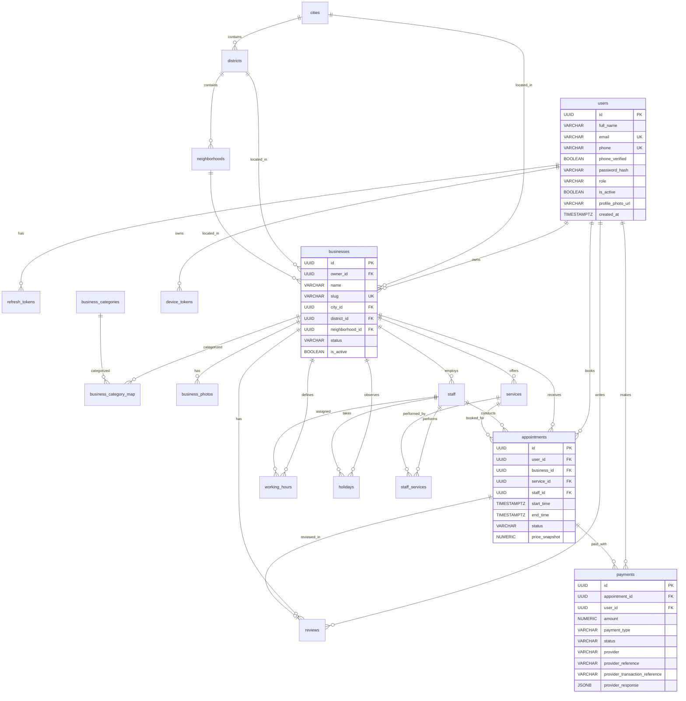

---

### 5.5. Veri Sözlüğü (Data Dictionary)

#### Tablo: `users`
| Kolon | Tip | Kısıtlar | Açıklama |
| :--- | :--- | :--- | :--- |
| `id` | UUID | PRIMARY KEY | Benzersiz kullanıcı tekil kimliği |
| `full_name` | VARCHAR(100) | NOT NULL | Kullanıcının adı ve soyadı |
| `email` | VARCHAR(150) | UNIQUE, Nullable | E-posta adresi |
| `phone` | VARCHAR(20) | NOT NULL, UNIQUE | Giriş ve OTP için zorunlu telefon numarası |
| `phone_verified` | BOOLEAN | NOT NULL, DEFAULT FALSE | SMS OTP ile telefonun doğrulanıp doğrulanmadığı |
| `password_hash` | VARCHAR(255) | NOT NULL | BCrypt ile şifrelenmiş parola özeti |
| `role` | VARCHAR(30) | NOT NULL | Kullanıcı yetki rolü (`USER`, `BUSINESS_OWNER`, `BUSINESS_EMPLOYEE`, `ADMIN`) |
| `is_active` | BOOLEAN | NOT NULL, DEFAULT TRUE | Hesabın aktiflik durumu |
| `profile_photo_url` | VARCHAR(500) | Nullable | R2 CDN üzerindeki profil görseli bağlantısı |
| `created_at` | TIMESTAMPTZ | NOT NULL, DEFAULT NOW() | Kayıt oluşturulma zamanı |
| `updated_at` | TIMESTAMPTZ | NOT NULL, DEFAULT NOW() | Son güncelleme zamanı |

#### Tablo: `refresh_tokens`
| Kolon | Tip | Kısıtlar | Açıklama |
| :--- | :--- | :--- | :--- |
| `id` | UUID | PRIMARY KEY | Token kayıt kimliği |
| `user_id` | UUID | NOT NULL, REFERENCES users(id) | Token sahibi kullanıcı |
| `token_hash` | VARCHAR(255) | NOT NULL, UNIQUE | Ham token'ın SHA-256 hash'i |
| `expires_at` | TIMESTAMPTZ | NOT NULL | Token geçerlilik son kullanma tarihi |
| `revoked` | BOOLEAN | NOT NULL, DEFAULT FALSE | Token iptal edilmiş mi (logout / rotasyon) |
| `created_at` | TIMESTAMPTZ | NOT NULL, DEFAULT NOW() | Oluşturulma tarihi |
| `updated_at` | TIMESTAMPTZ | NOT NULL, DEFAULT NOW() | Güncelleme tarihi |

#### Tablo: `cities`
| Kolon | Tip | Kısıtlar | Açıklama |
| :--- | :--- | :--- | :--- |
| `id` | UUID | PRIMARY KEY | Şehir kimliği |
| `name` | VARCHAR(100) | NOT NULL, UNIQUE | Şehir adı (örn. İstanbul, Ankara) |
| `code` | VARCHAR(10) | Nullable | İl plaka kodu (örn. 34, 06) |
| `is_active` | BOOLEAN | NOT NULL, DEFAULT TRUE | Aktiflik bayrağı |
| `created_at` | TIMESTAMPTZ | NOT NULL, DEFAULT NOW() | Oluşturulma tarihi |
| `updated_at` | TIMESTAMPTZ | NOT NULL, DEFAULT NOW() | Güncelleme tarihi |

#### Tablo: `districts`
| Kolon | Tip | Kısıtlar | Açıklama |
| :--- | :--- | :--- | :--- |
| `id` | UUID | PRIMARY KEY | İlçe kimliği |
| `city_id` | UUID | NOT NULL, REFERENCES cities(id) | Bağlı olduğu il |
| `name` | VARCHAR(100) | NOT NULL | İlçe adı (örn. Kadıköy) |
| `is_active` | BOOLEAN | NOT NULL, DEFAULT TRUE | Aktiflik bayrağı |
| - | - | UNIQUE (city_id, name) | Bir ilde aynı isimde tek ilçe kısıtı |
| `created_at` | TIMESTAMPTZ | NOT NULL, DEFAULT NOW() | Oluşturulma tarihi |
| `updated_at` | TIMESTAMPTZ | NOT NULL, DEFAULT NOW() | Güncelleme tarihi |

#### Tablo: `neighborhoods`
| Kolon | Tip | Kısıtlar | Açıklama |
| :--- | :--- | :--- | :--- |
| `id` | UUID | PRIMARY KEY | Mahalle kimliği |
| `district_id` | UUID | NOT NULL, REFERENCES districts(id) | Bağlı olduğu ilçe |
| `name` | VARCHAR(150) | NOT NULL | Mahalle adı (örn. Moda, Caddebostan) |
| `is_active` | BOOLEAN | NOT NULL, DEFAULT TRUE | Aktiflik bayrağı |
| - | - | UNIQUE (district_id, name) | Bir ilçede aynı isimde tek mahalle |
| `created_at` | TIMESTAMPTZ | NOT NULL, DEFAULT NOW() | Oluşturulma tarihi |
| `updated_at` | TIMESTAMPTZ | NOT NULL, DEFAULT NOW() | Güncelleme tarihi |

#### Tablo: `business_categories`
| Kolon | Tip | Kısıtlar | Açıklama |
| :--- | :--- | :--- | :--- |
| `id` | UUID | PRIMARY KEY | Kategori kimliği |
| `name` | VARCHAR(100) | NOT NULL, UNIQUE | Kategori adı (örn. Berber, Klinik, Masaj) |
| `slug` | VARCHAR(100) | NOT NULL, UNIQUE | URL dostu takma ad (örn. berber, klinik) |
| `description` | TEXT | Nullable | Kategori açıklaması |
| `icon_url` | VARCHAR(500) | Nullable | Kategori ikonu bağlantısı |
| `is_active` | BOOLEAN | NOT NULL, DEFAULT TRUE | Kategori aktifliği |
| `sort_order` | INT | NOT NULL, DEFAULT 0 | Listeleme sıralaması |
| `created_at` | TIMESTAMPTZ | NOT NULL, DEFAULT NOW() | Oluşturulma tarihi |
| `updated_at` | TIMESTAMPTZ | NOT NULL, DEFAULT NOW() | Güncelleme tarihi |

#### Tablo: `businesses`
| Kolon | Tip | Kısıtlar | Açıklama |
| :--- | :--- | :--- | :--- |
| `id` | UUID | PRIMARY KEY | İşletme kimliği |
| `owner_id` | UUID | NOT NULL, REFERENCES users(id) | İşletme sahibi kullanıcı |
| `name` | VARCHAR(150) | NOT NULL | İşletme ticari adı |
| `slug` | VARCHAR(150) | NOT NULL, UNIQUE | URL dostu benzersiz işletme takma adı |
| `description` | TEXT | Nullable | İşletme tanıtım yazısı |
| `phone` | VARCHAR(20) | Nullable | İşletme iletişim telefonu |
| `email` | VARCHAR(150) | Nullable | İşletme iletişim e-postası |
| `website` | VARCHAR(300) | Nullable | Resmi web sitesi bağlantısı |
| `city_id` | UUID | REFERENCES cities(id) | İl ilişkisi |
| `district_id` | UUID | REFERENCES districts(id) | İlçe ilişkisi |
| `neighborhood_id` | UUID | REFERENCES neighborhoods(id) | Mahalle ilişkisi |
| `address_line` | VARCHAR(300) | Nullable | Açık adres satırı |
| `latitude` | DOUBLE PRECISION| Nullable | Harita enlem koordinatı |
| `longitude` | DOUBLE PRECISION| Nullable | Harita boylam koordinatı |
| `status` | VARCHAR(30) | NOT NULL, DEFAULT 'PENDING' | İşletme onay durumu (`PENDING`, `APPROVED`, `REJECTED`, `SUSPENDED`) |
| `rejection_reason` | TEXT | Nullable | Admin red veya askıya alma gerekçesi |
| `is_active` | BOOLEAN | NOT NULL, DEFAULT TRUE | Genel aktiflik durumu |
| `created_at` | TIMESTAMPTZ | NOT NULL, DEFAULT NOW() | Oluşturulma tarihi |
| `updated_at` | TIMESTAMPTZ | NOT NULL, DEFAULT NOW() | Güncelleme tarihi |

#### Tablo: `business_category_map`
| Kolon | Tip | Kısıtlar | Açıklama |
| :--- | :--- | :--- | :--- |
| `business_id` | UUID | NOT NULL, REFERENCES businesses(id) | İşletme kimliği |
| `category_id` | UUID | NOT NULL, REFERENCES business_categories(id)| Kategori kimliği |
| - | - | PRIMARY KEY (business_id, category_id) | Çoka-çok ilişki birincil anahtarı |

#### Tablo: `business_photos`
| Kolon | Tip | Kısıtlar | Açıklama |
| :--- | :--- | :--- | :--- |
| `id` | UUID | PRIMARY KEY | Fotoğraf kimliği |
| `business_id` | UUID | NOT NULL, REFERENCES businesses(id) | Ait olduğu işletme |
| `url` | VARCHAR(500) | NOT NULL | Cloudflare R2 CDN genel URL'i |
| `file_name` | VARCHAR(255) | NOT NULL | Orijinal dosya adı |
| `file_size` | INT | Nullable | Dosya boyutu (byte) |
| `mime_type` | VARCHAR(100) | Nullable | MIME türü (image/jpeg, image/png vb.) |
| `is_cover` | BOOLEAN | NOT NULL, DEFAULT FALSE | Kapak fotoğrafı mı? |
| `sort_order` | INT | NOT NULL, DEFAULT 0 | Galeri gösterim sırası |
| `created_at` | TIMESTAMPTZ | NOT NULL, DEFAULT NOW() | Oluşturulma tarihi |
| `updated_at` | TIMESTAMPTZ | NOT NULL, DEFAULT NOW() | Güncelleme tarihi |

#### Tablo: `services`
| Kolon | Tip | Kısıtlar | Açıklama |
| :--- | :--- | :--- | :--- |
| `id` | UUID | PRIMARY KEY | Hizmet kimliği |
| `business_id` | UUID | NOT NULL, REFERENCES businesses(id) | Hizmeti veren işletme |
| `name` | VARCHAR(150) | NOT NULL | Hizmet başlığı (örn. Saç Kesimi, Cilt Bakımı) |
| `description` | TEXT | Nullable | Hizmet içeriği ve detayları |
| `duration_min` | INT | NOT NULL | Hizmet süresi (dakika) |
| `price` | NUMERIC(10,2)| NOT NULL | Hizmet birim fiyatı |
| `currency` | VARCHAR(10) | NOT NULL, DEFAULT 'TRY' | Para birimi |
| `image_url` | VARCHAR(500) | Nullable | Hizmet tanıtım görseli |
| `is_active` | BOOLEAN | NOT NULL, DEFAULT TRUE | Hizmet yayında mı? |
| `sort_order` | INT | NOT NULL, DEFAULT 0 | Sıralama |
| `created_at` | TIMESTAMPTZ | NOT NULL, DEFAULT NOW() | Oluşturulma tarihi |
| `updated_at` | TIMESTAMPTZ | NOT NULL, DEFAULT NOW() | Güncelleme tarihi |

#### Tablo: `staff`
| Kolon | Tip | Kısıtlar | Açıklama |
| :--- | :--- | :--- | :--- |
| `id` | UUID | PRIMARY KEY | Personel kimliği |
| `business_id` | UUID | NOT NULL, REFERENCES businesses(id) | Çalıştığı işletme |
| `user_id` | UUID | REFERENCES users(id), Nullable | Eşleşen kullanıcı hesabı |
| `full_name` | VARCHAR(100) | NOT NULL | Personelin adı soyadı |
| `title` | VARCHAR(100) | Nullable | Unvanı (Kıdemli Kuaför, Uzman Diyetisyen vb.) |
| `bio` | TEXT | Nullable | Özgeçmiş / biyografi |
| `profile_photo_url` | VARCHAR(500) | Nullable | Profil görseli |
| `is_active` | BOOLEAN | NOT NULL, DEFAULT TRUE | Personel aktif çalışıyor mu? |
| `sort_order` | INT | NOT NULL, DEFAULT 0 | Sıralama |
| `created_at` | TIMESTAMPTZ | NOT NULL, DEFAULT NOW() | Oluşturulma tarihi |
| `updated_at` | TIMESTAMPTZ | NOT NULL, DEFAULT NOW() | Güncelleme tarihi |

#### Tablo: `staff_services`
| Kolon | Tip | Kısıtlar | Açıklama |
| :--- | :--- | :--- | :--- |
| `staff_id` | UUID | NOT NULL, REFERENCES staff(id) | Personel kimliği |
| `service_id` | UUID | NOT NULL, REFERENCES services(id) | Verebildiği hizmet |
| - | - | PRIMARY KEY (staff_id, service_id) | Çoka-çok ilişki birincil anahtarı |

#### Tablo: `working_hours`
| Kolon | Tip | Kısıtlar | Açıklama |
| :--- | :--- | :--- | :--- |
| `id` | UUID | PRIMARY KEY | Çalışma saati kayıt kimliği |
| `business_id` | UUID | NOT NULL, REFERENCES businesses(id) | İlgili işletme |
| `staff_id` | UUID | REFERENCES staff(id), Nullable | İlgili personel (null ise işletme geneli) |
| `day_of_week` | SMALLINT | NOT NULL | Haftanın günü (1=Pazartesi, 7=Pazar) |
| `open_time` | TIME | NOT NULL | Mesai başlangıç saati |
| `close_time` | TIME | NOT NULL | Mesai bitiş saati |
| `is_closed` | BOOLEAN | NOT NULL, DEFAULT FALSE | O gün kapalı/tatil mi? |
| - | - | UNIQUE (business_id, staff_id, day_of_week) | Aynı gün için tek saat tanımı kısıtı |
| `created_at` | TIMESTAMPTZ | NOT NULL, DEFAULT NOW() | Oluşturulma tarihi |
| `updated_at` | TIMESTAMPTZ | NOT NULL, DEFAULT NOW() | Güncelleme tarihi |

#### Tablo: `holidays`
| Kolon | Tip | Kısıtlar | Açıklama |
| :--- | :--- | :--- | :--- |
| `id` | UUID | PRIMARY KEY | Tatil kimliği |
| `business_id` | UUID | NOT NULL, REFERENCES businesses(id) | İlgili işletme |
| `staff_id` | UUID | REFERENCES staff(id), Nullable | İlgili personel (null ise genel tatil) |
| `date` | DATE | NOT NULL | Tatil / izin tarihi |
| `reason` | VARCHAR(200) | Nullable | Tatil gerekçesi |
| `created_at` | TIMESTAMPTZ | NOT NULL, DEFAULT NOW() | Oluşturulma tarihi |
| `updated_at` | TIMESTAMPTZ | NOT NULL, DEFAULT NOW() | Güncelleme tarihi |

#### Tablo: `appointments`
| Kolon | Tip | Kısıtlar | Açıklama |
| :--- | :--- | :--- | :--- |
| `id` | UUID | PRIMARY KEY | Randevu kimliği |
| `user_id` | UUID | NOT NULL, REFERENCES users(id) | Randevuyu alan müşteri |
| `business_id` | UUID | NOT NULL, REFERENCES businesses(id) | Randevu alınan işletme |
| `service_id` | UUID | NOT NULL, REFERENCES services(id) | Alınan hizmet |
| `staff_id` | UUID | REFERENCES staff(id), Nullable | Atanan personel (isteğe bağlı) |
| `start_time` | TIMESTAMPTZ | NOT NULL | Randevu başlangıç zamanı |
| `end_time` | TIMESTAMPTZ | NOT NULL | Randevu bitiş zamanı |
| `status` | VARCHAR(30) | NOT NULL, DEFAULT 'PENDING' | Randevu yaşam döngüsü durumu |
| `price_snapshot` | NUMERIC(10,2)| NOT NULL | Randevu anındaki sabitlenmiş hizmet ücreti |
| `currency` | VARCHAR(10) | NOT NULL, DEFAULT 'TRY' | Para birimi |
| `notes` | TEXT | Nullable | Müşteri özel istekleri / notları |
| `cancellation_reason`| TEXT | Nullable | İptal durumunda belirtilen gerekçe |
| - | - | EXCLUDE USING gist (staff_id WITH =, tstzrange(start_time, end_time, '[)') WITH &&) WHERE (status IN ('PENDING', 'CONFIRMED') AND staff_id IS NOT NULL) | GiST zaman çakışması engelleme kısıtı |
| `created_at` | TIMESTAMPTZ | NOT NULL, DEFAULT NOW() | Oluşturulma tarihi |
| `updated_at` | TIMESTAMPTZ | NOT NULL, DEFAULT NOW() | Güncelleme tarihi |

#### Tablo: `reviews`
| Kolon | Tip | Kısıtlar | Açıklama |
| :--- | :--- | :--- | :--- |
| `id` | UUID | PRIMARY KEY | Değerlendirme kimliği |
| `appointment_id` | UUID | NOT NULL, UNIQUE, REFERENCES appointments(id)| Değerlendirilen randevu (1 randevuya 1 yorum) |
| `user_id` | UUID | NOT NULL, REFERENCES users(id) | Yorumu yazan müşteri |
| `business_id` | UUID | NOT NULL, REFERENCES businesses(id) | Yorum yapılan işletme |
| `rating` | SMALLINT | NOT NULL, CHECK (rating BETWEEN 1 AND 5)| 1 ile 5 arasında verilen memnuniyet puanı |
| `comment` | TEXT | Nullable | Müşteri yorum metni |
| `is_visible` | BOOLEAN | NOT NULL, DEFAULT TRUE | Moderasyon görünürlük durumu |
| `created_at` | TIMESTAMPTZ | NOT NULL, DEFAULT NOW() | Oluşturulma tarihi |
| `updated_at` | TIMESTAMPTZ | NOT NULL, DEFAULT NOW() | Güncelleme tarihi |

#### Tablo: `device_tokens`
| Kolon | Tip | Kısıtlar | Açıklama |
| :--- | :--- | :--- | :--- |
| `id` | UUID | PRIMARY KEY | Cihaz token kimliği |
| `user_id` | UUID | NOT NULL, REFERENCES users(id) | Cihazın sahibi kullanıcı |
| `token` | VARCHAR(500) | NOT NULL, UNIQUE | Firebase FCM registration token |
| `platform` | VARCHAR(20) | NOT NULL | Cihaz platformu (`ANDROID`, `IOS`, `WEB`) |
| `is_active` | BOOLEAN | NOT NULL, DEFAULT TRUE | Token aktif mi? |
| `created_at` | TIMESTAMPTZ | NOT NULL, DEFAULT NOW() | Oluşturulma tarihi |
| `updated_at` | TIMESTAMPTZ | NOT NULL, DEFAULT NOW() | Güncelleme tarihi |

#### Tablo: `payments`
| Kolon | Tip | Kısıtlar | Açıklama |
| :--- | :--- | :--- | :--- |
| `id` | UUID | PRIMARY KEY | Ödeme kayıt kimliği |
| `appointment_id` | UUID | NOT NULL, REFERENCES appointments(id)| Ödemesi yapılan randevu |
| `user_id` | UUID | NOT NULL, REFERENCES users(id) | Ödemeyi yapan müşteri |
| `amount` | NUMERIC(10,2)| NOT NULL | Tahsil edilen tutar |
| `currency` | VARCHAR(10) | NOT NULL, DEFAULT 'TRY' | Para birimi |
| `payment_type` | VARCHAR(30) | NOT NULL | `DEPOSIT` (kapora) veya `FULL` (tam ödeme) |
| `status` | VARCHAR(30) | NOT NULL, DEFAULT 'INITIATED'| Ödeme durumu (`INITIATED`, `PENDING`, `SUCCESS`, `FAIL`, `REFUNDED`) |
| `provider` | VARCHAR(30) | Nullable | Ödeme altyapısı (örn. IYZICO) |
| `provider_reference` | VARCHAR(255)| Nullable (V4 migration notuna bakınız) | iyzico paymentId |
| `provider_transaction_reference`| VARCHAR(255)| Nullable | iyzico paymentTransactionId (iade referansı) |
| `provider_response`| JSONB | Nullable | iyzico ham JSON yanıtı (kart bilgisi içermez) |
| `created_at` | TIMESTAMPTZ | NOT NULL, DEFAULT NOW() | Oluşturulma tarihi |
| `updated_at` | TIMESTAMPTZ | NOT NULL, DEFAULT NOW() | Güncelleme tarihi |

---
## 6. İş Akışları ve Yaşam Döngüsü Analizi

### 6.1. Randevu Yaşam Döngüsü ve Durum Geçişleri
Randevu durumları `com.yunus.appointment.entity.AppointmentStatus` enum'ı altında yönetilir. Sistemde fiziksel randevu silme (hard-delete) uygulanmaz; tüm yaşam döngüsü durum güncellemeleri üzerinden akar.

#### Durum Geçiş Matrisi ve Tetikleyici Roller:
1. `[*] -> PENDING`: **USER** tarafından randevu oluşturulduğunda (`createAppointment`).
2. `PENDING -> CONFIRMED`: **BUSINESS_OWNER** veya randevuya **Atanmış Personel (BUSINESS_EMPLOYEE)** tarafından randevu onaylandığında (`confirmAppointment`) veya başarılı bir iyzico ödemesi tamamlandığında (`handleCallback`).
3. `PENDING -> CANCELLED_BY_USER`: Randevuyu oluşturan **USER** tarafından iptal edildiğinde (`cancelAppointmentByUser`).
4. `PENDING -> CANCELLED_BY_BUSINESS`: **BUSINESS_OWNER** veya **Atanmış Personel** tarafından gerekçe belirtilerek iptal edildiğinde (`cancelAppointmentByBusiness`).
5. `CONFIRMED -> CANCELLED_BY_USER`: **USER** tarafından randevu vaktinden önce iptal edildiğinde.
6. `CONFIRMED -> CANCELLED_BY_BUSINESS`: **BUSINESS_OWNER** veya **Atanmış Personel** tarafından iptal edildiğinde.
7. `CONFIRMED -> COMPLETED`: **BUSINESS_OWNER** veya **Atanmış Personel** tarafından hizmet tamamlandığında (`completeAppointment`).
8. `CONFIRMED -> NO_SHOW`: **BUSINESS_OWNER** veya **Atanmış Personel** tarafından müşteri gelmediğinde (`markNoShow`).
9. `EXPIRED`: *Enum olarak tanımlıdır, ancak kod tabanında otomatik cron/zamanlayıcı geçişi bulunamamıştır.*

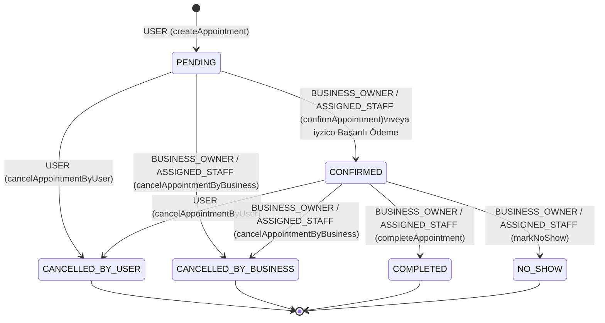

---

### 6.2. Uçtan Uca Kritik İş Akışları ve Sıralama Diyagramları

#### Akış 1: Kullanıcı Kayıt ve Giriş (Access & Refresh Token Alma)
1. İstemci `POST /api/v1/auth/register` veya `POST /api/v1/auth/login` isteği gönderir.
2. `RateLimitInterceptor` IP bazlı istek sınırını (kayıt için 1 saatte 5, giriş için 15 dakikada 10) Redis ZSET ile kontrol eder.
3. Giriş akışında `AuthenticationManager` kullanıcı şifresini BCrypt ile doğrular.
4. `JwtService`, 15 dakikalık Access Token üretir (içerisinde `userId`, `role` ve `sub: phone` claim'leri bulunur).
5. `RefreshTokenService`, kriptografik rastgele bir UUID (raw refresh token) üretir, SHA-256 algoritmasıyla hash'ler ve veritabanındaki `refresh_tokens` tablosuna 7 günlük geçerlilikle yazar.
6. İstemciye `AuthResponse` içerisinde hem Access Token hem de ham Refresh Token döner.

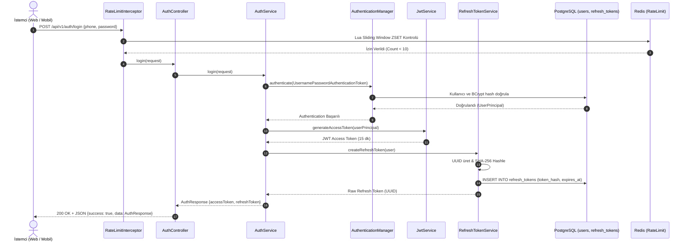

---

#### Akış 2: Token Yenileme (Refresh Token Rotasyonu)
1. Access token süresi dolan istemci `POST /api/v1/auth/refresh` endpoint'ine ham refresh token ile başvurur.
2. `RefreshTokenService.validateRefreshToken`, gelen ham token'ın SHA-256 hash'ini alır ve veritabanında arar.
3. Token'ın iptal edilip edilmediği (`revoked == false`) ve süresinin dolup dolmadığı kontrol edilir.
4. `rotateRefreshToken`: Eski token veritabanında `revoked = true` yapılarak anında geçersiz kılınır.
5. Kullanıcı için yeni bir refresh token (UUID) üretilir, SHA-256 hash'i DB'ye kaydedilir.
6. Yeni access token ve yeni refresh token ikilisi istemciye iletilir (Token Rotation).

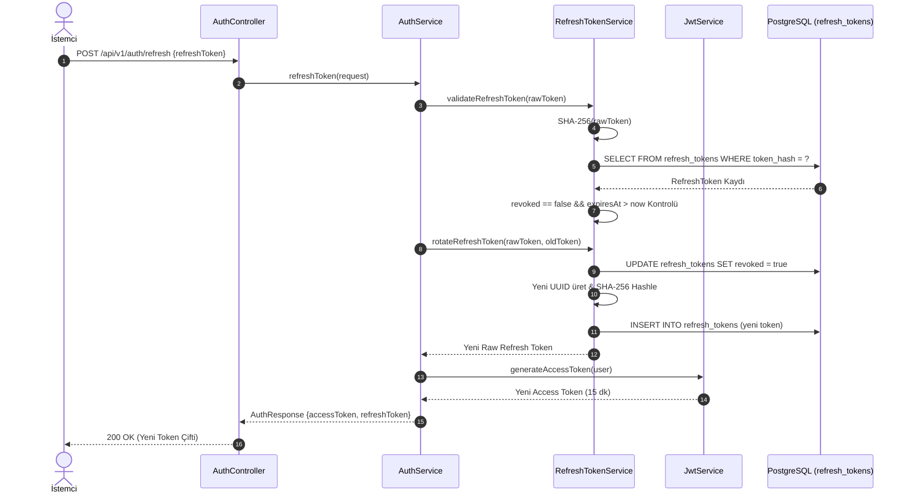

---

#### Akış 3: Randevu Oluşturma (Çift Rezervasyon Koruması ile)
1. İstemci `POST /api/v1/appointments` isteği atar (`businessId`, `serviceId`, `staffId`, `startTime`, `notes`).
2. `RateLimitInterceptor` kullanıcı bazında (1 saatte 20 randevu) sınır kontrolü yapar.
3. `AppointmentServiceImpl` oturum açmış kullanıcıyı doğrular; işletmenin, hizmetin ve personelin varlığını ve aktifliğini kontrol eder.
4. Hizmet süresi eklenerek `endTime = startTime + durationMin` hesaplanır.
5. **SlotLockService:** Redis üzerinde `slot:lock:{businessId}:{staffId}:{startTime}` anahtarıyla atomik kilit (`SETNX`) denenir. Kilit alınamazsa `409 Conflict (SlotAlreadyTakenException)` fırlatılır.
6. **DB Çakışma Kontrolü:** Uygulama seviyesinde `existsOverlappingByStaff` çağrısıyla aktif randevular taranır. Çakışma varsa Redis kilidi bırakılır ve 409 fırlatılır.
7. Randevu entity'si `PENDING` durumunda hazırlanır; hizmetin o anki birim fiyatı `priceSnapshot` alanına dondurularak `saveAndFlush` ile PostgreSQL'e yazılır.
8. Veritabanı seviyesinde V2 Partial Unique Index ve V3 GiST Exclusion Constraint devrededir; yarış durumu oluşmuşsa DB işlemi reddeder.
9. Başarılı kaydın ardından işletme sahibine FCM üzerinden anlık push bildirim gönderilir.

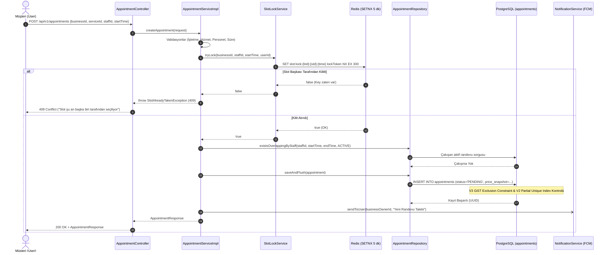

---

#### Akış 4: Randevu İptali (Kullanıcı ve İşletme)
1. **Kullanıcı İptali:** `PATCH /api/v1/appointments/{id}/cancel-by-user`
   - Randevunun sahibi (`appointment.user.id == currentUserId`) olduğu doğrulanır.
   - Sadece `PENDING` veya `CONFIRMED` randevular iptal edilebilir.
   - Durum `CANCELLED_BY_USER` yapılır, iptal gerekçesi kaydedilir.
   - Redis slot kilidi serbest bırakılmak üzere çağrılır.
   - İşletme sahibine push bildirim iletilir.
2. **İşletme İptali:** `PATCH /api/v1/appointments/{id}/cancel-by-business`
   - Çağıran kullanıcının işletme sahibi veya randevuya atanmış personel olduğu doğrulanır.
   - Durum `CANCELLED_BY_BUSINESS` yapılır, gerekçe girilir.
   - Müşteriye push bildirim gönderilir.

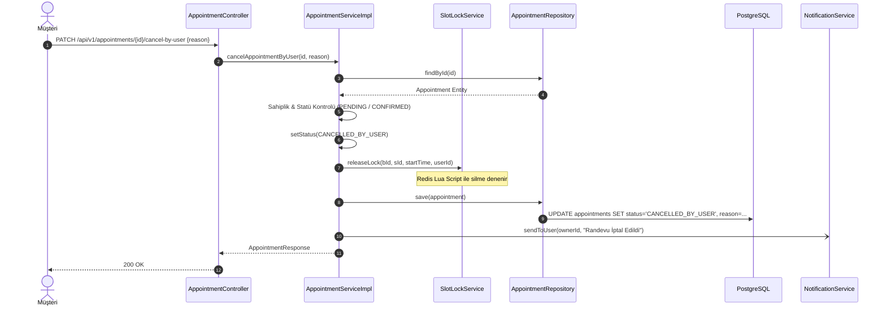

---

#### Akış 5: İşletmenin Çalışma Saati ve Hizmet Tanımlaması
1. İşletme sahibi `PUT /api/v1/businesses/{businessId}/working-hours` veya `POST /api/v1/businesses/{businessId}/services` isteğinde bulunur.
2. `BusinessOwnershipValidator.validateOwnership` çağrılarak oturum açan kullanıcının işletmenin gerçek sahibi olduğu doğrulanır. Sahip değilse işlem durdurularak `403 Forbidden` döner.
3. Çalışma saati güncellemesinde haftanın 7 günü için açılış, kapanış ve kapalı olma durumu veritabanında toplu (bulk) olarak güncellenir.
4. Hizmet eklemede ad, süre (`durationMin`), fiyat (`price`) bilgileri kaydedilir; bu süre daha sonra slot üretiminde adım aralığı olarak kullanılır.

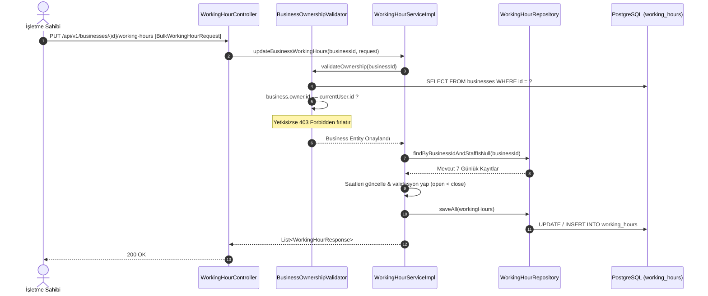

---

#### Akış 6: Dosya ve Görsel Yükleme (Cloudflare R2 / AWS S3)
1. İstemci `POST /api/v1/businesses/{businessId}/photos` endpoint'ine `MultipartFile` gönderir.
2. `BusinessOwnershipValidator` işletme sahipliğini kontrol eder.
3. `R2StorageService.uploadFile` dosyanın uzantısını ayıklar, rastgele bir UUID oluşturarak `businesses/{businessId}/{uuid}.jpg` formatında depolama anahtarı (key) üretir.
4. Dosya uzantısına göre MIME Type tespiti yapılır (`image/jpeg`, `image/png`, `image/webp`).
5. AWS S3 SDK `S3Client.putObject` ile Cloudflare R2 bucket'ına byte dizisi yüklenir.
6. CDN genel erişim URL'i (`storageProperties.publicUrl() + "/" + key`) veritabanındaki `business_photos` tablosuna kaydedilir ve DTO olarak istemciye iletilir.

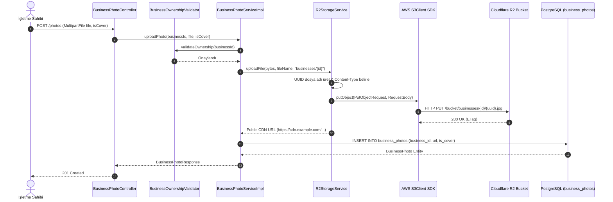

---

#### Akış 7: Ödeme Başlatma ve iyzico 3DS Callback Akışı
1. İstemci `POST /api/v1/payments/initiate` isteğiyle randevu ID'si ve kart bilgilerini iletir.
2. `IyzicoPaymentServiceImpl`:
   - Randevunun kullanıcıya ait olduğunu ve `PENDING` veya `CONFIRMED` durumunda olduğunu doğrular.
   - Bu randevu için önceden başarılı bir ödeme olup olmadığını kontrol eder.
   - Hizmet fiyatı ve `iyzico.deposit-rate` (varsayılan: %20) üzerinden kapora tutarını hesaplar.
   - Veritabanına `INITIATED` durumunda bir `Payment` kaydı açar.
   - iyzico SDK'sına `CreatePaymentRequest` (sepet, alıcı, kart ve 3DS callback URL) gönderir.
   - iyzico'dan dönen 3DS HTML içeriğini alır, ödeme kaydını `PENDING` durumuna çeker ve HTML formunu istemciye döner.
3. İstemci tarayıcısı dönen HTML içeriğini render ederek kullanıcıyı bankanın 3DS SMS onay sayfasına yönlendirir.
4. Banka onayı sonrası iyzico, arka uçtaki `POST /api/v1/payments/callback` endpoint'ine form verisi postalar.
5. **Callback Idempotency:** Callback çağrıldığında ödeme zaten `SUCCESS` ise işlem tekrarlanmaz; doğrudan frontend başarılı sayfasına yönlendirilir.
6. `mdStatus == 1` ise iyzico'ya `ThreedsPayment.create` ile tamamlama çağrısı yapılır.
7. Ödeme `SUCCESS` durumuna geçirilir, `provider_reference` (paymentId) ve `provider_transaction_reference` (paymentTransactionId) kaydedilir.
8. İlişkili randevu otomatik olarak `CONFIRMED` statüsüne yükseltilir.
9. İstemci frontend ödeme sonuç sayfasına yönlendirilir (`/odeme/sonuc?status=basarili&id=...`).

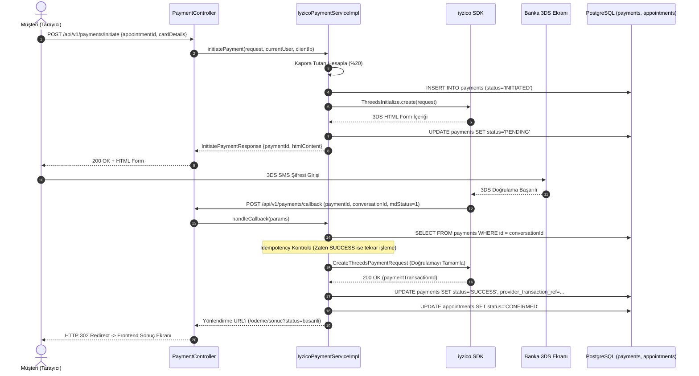

---
## 7. Kritik Mekanizmalar (Derinlemesine İnceleme ve Kod Analizi)

Bu bölüm, sistemin tutarlılık, güvenlik ve yüksek eşzamanlılık (concurrency) altındaki dayanıklılığını sağlayan çekirdek mekanizmaları kaynak kod düzeyinde ele almaktadır.

---

### 7.1. Çift Rezervasyon Önleme Mekanizması (Double-Booking Prevention)

Randevu sistemlerinin en kritik mühendislik problemi, aynı zaman dilimine birden fazla kullanıcının eşzamanlı olarak rezervasyon yapmasını engellemektir. Sistem bu problemi çözmek için **4 Katmanlı Savunma Hattı** kullanır:

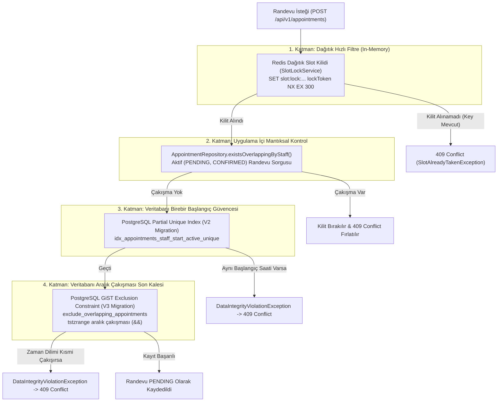

#### Katmanların Detaylı Sıralaması:
1. **1. Katman (Redis Dağıtık Kilidi):** Veritabanına gereksiz yazma/okuma yükü bindirmemek için ilk savunma hattıdır. `SETNX` ile 5 dakikalık geçici kilit alınır.
2. **2. Katman (Uygulama İçi DB Kontrolü):** Kilit alındıktan sonra veritabanında aktif statüdeki randevular taranır (`existsOverlappingByStaff`).
3. **3. Katman (PostgreSQL Partial Unique Index - V2):** Redis devre dışı kalsa veya race condition oluşsa dahi, aynı personel ve aynı başlangıç saatine (`staff_id, start_time`) sahip iki aktif randevunun yazılmasını engeller.
4. **4. Katman (PostgreSQL GiST Exclusion Constraint - V3):** Farklı sürelerdeki (örneğin 10:00-11:00 randevusu varken 10:30-11:30) kısmi aralık çakışmalarını veritabanı motoru (`btree_gist` ve `tstzrange`) seviyesinde garanti altına alır.

#### Redis Kilit Formatı ve TTL:
- **Anahtar (Key) Formatı:** `slot:lock:{businessId}:{staffId}:{startTime}`  
  *(Personel seçilmemişse staffId yerine `"none"` string'i kullanılır).*
- **TTL Süresi:** 5 Dakika (`Duration.ofMinutes(5)`). Bu süre, müşterinin randevu formunu doldurup ödeme aşamasına geçmesi için ayrılan geçici tutma süresidir.
- **Kilit Alma Metodu:** `redisTemplate.opsForValue().setIfAbsent(key, lockToken, LOCK_TTL)` (Atomik `SETNX EX`).

---

#### Kilit Bırakma Kodundaki Hatanın Tespiti ve Açıklanması (Kritik Bulgu)

`SlotLockService.java` sınıfı incelendiğinde kilit bırakma mantığında ciddi bir tasarım ve eşleşme hatası tespit edilmiştir.

**Hatalı Kod Parçası (`src/main/java/com/yunus/appointment/service/SlotLockService.java`, Satır 120-132):**
```java
// SlotLockService.java içerisindeki orijinal kod:

/**
 * Rastgele UUID token oluşturarak kilit dener (istek başına benzersiz token).
 */
public boolean tryLock(UUID businessId, UUID staffId, OffsetDateTime startTime, UUID userId) {
    String token = UUID.randomUUID().toString(); // <--- RASTGELE UUID TOKEN ÜRETİLİYOR!
    return tryAcquire(businessId, staffId, startTime, token); // Redis'e bu rastgele token yazılıyor!
}

/**
 * Lua compare-and-delete kullanarak kilidi atomik olarak serbest bırakır (geriye dönük uyumluluk).
 */
public void releaseLock(UUID businessId, UUID staffId, OffsetDateTime startTime, UUID userId) {
    if (userId != null) {
        release(businessId, staffId, startTime, userId.toString()); // <--- BURADA userId GÖNDERİLİYOR!
    }
}
```

**Kullanılan Lua Betiği (`RELEASE_LOCK_SCRIPT`):**
```lua
if redis.call('get', KEYS[1]) == ARGV[1] then
    return redis.call('del', KEYS[1])
else
    return 0
end
```

#### 1. Ne Yanlış?
- `tryLock` metodu çağrıldığında parametre olarak gelen `userId` tamamen göz ardı edilmekte; bunun yerine `UUID.randomUUID().toString()` ile yeni ve rastgele bir string token oluşturulup Redis'e yazılmaktadır. Üretilen bu rastgele token ne geri döndürülmekte ne de herhangi bir yerde saklanmaktadır.
- Ancak kilidi kaldırmak için çağrılan `releaseLock` metodu, Redis'e `ARGV[1]` değeri olarak `userId.toString()` değerini göndermektedir.
- Redis'teki Lua scripti `redis.call('get', KEYS[1]) == ARGV[1]` kontrolü yaptığında, rastgele üretilen UUID değeri ile `userId.toString()` değeri **asla eşit olamaz**. Bu nedenle Lua betiği daima `0` döner ve Redis anahtarı **hiçbir zaman silinmez**.

#### 2. Hangi Durumlarda Ortaya Çıkar?
- **Durum 1 (DB Çakışmasında Erken Bırakma Başarısızlığı):** `AppointmentServiceImpl.createAppointment()` içinde kilit alındıktan sonra 2. katmandaki `existsOverlappingByStaff` kontrolü çakışma tespit ederse, `slotLockService.releaseLock(...)` çağrılır. Bu çağrı anahtarı silemediği için slot 5 dakika boyunca kilitli kalır ve başka kullanıcılar boş olan slotu alamaz.
- **Durum 2 (Kullanıcı Randevu İptali):** `cancelAppointmentByUser` çağrıldığında randevu iptal edilir edilmez slotun diğer müşterilere açılması için `releaseLock` çağrılır. Ancak anahtar silinemediği için slot kilitli kalmaya devam eder.
- **Durum 3 (İşletme Randevu İptali):** `cancelAppointmentByBusiness` çağrıldığında da aynı şekilde kilit erken serbest bırakılamaz.

#### 3. Nasıl Düzeltilir?
Sorun iki alternatif yolla çözülebilir:

*Çözüm Yolu A (Basit ve Geriye Dönük Uyumlu - Tavsiye Edilen):*  
`tryLock` metodunda rastgele token yerine doğrudan `userId.toString()` değeri kilit sahibi token'ı olarak kullanılmalıdır:
```java
// DÜZELTİLMİŞ KOD:
public boolean tryLock(UUID businessId, UUID staffId, OffsetDateTime startTime, UUID userId) {
    String token = (userId != null) ? userId.toString() : UUID.randomUUID().toString();
    return tryAcquire(businessId, staffId, startTime, token);
}
```

*Çözüm Yolu B (Token Tabanlı İleri Seviye Çözüm):*  
`tryLock` metodu üretilen rastgele `String lockToken` değerini geri döndürmeli; çağıran servis (`AppointmentServiceImpl`) bu token'ı elinde tutarak kilit serbest bırakılırken `release(businessId, staffId, startTime, lockToken)` şeklinde iletmelidir.

---

### 7.2. Hız Sınırlayıcı (Rate Limiter)

Sistem, brute-force saldırılarını, spam kayıtları ve randevu slotlarının botlarla bloke edilmesini engellemek için **Redis Sorted Set (ZSET) tabanlı Sliding Window** algoritması kullanır.

*Kaynak Kod:* `src/main/java/com/yunus/ratelimit/interceptor/RateLimitInterceptor.java`

#### Algoritmanın Çalışma Mantığı ve Atomik Lua Betiği:
Her istek geldiğinde pencere süresi dışındaki eski kayıtlar temizlenir ve pencere içindeki güncel istek adedi sayılır. Bu işlem yarış durumlarını (race conditions) engellemek için tek bir atomik Lua scripti ile yürütülür:

```lua
local key = KEYS[1]
local windowStart = tonumber(ARGV[1])
local limit = tonumber(ARGV[2])
local now = tonumber(ARGV[3])
local member = ARGV[4]
local windowSeconds = tonumber(ARGV[5])

-- 1. Pencere dışındaki süresi geçmiş kayıtları ZREMRANGEBYSCORE ile temizle
redis.call('zremrangebyscore', key, '-inf', '(' .. windowStart)

-- 2. Pencere içindeki mevcut istek sayısını ZCARD ile al
local currentCount = redis.call('zcard', key)

-- 3. Sayı belirlenen limitten küçükse yeni isteği ZADD ile ekle ve TTL güncelle
if currentCount < limit then
    redis.call('zadd', key, now, member)
    redis.call('expire', key, windowSeconds)
    return 1 -- İzin verildi
else
    return 0 -- Limit aşıldı
end
```

#### Kullanılan Redis Komutları:
1. `ZREMRANGEBYSCORE key -inf (windowStart`: Sliding window'un solundaki eski istek skorlarını siler.
2. `ZCARD key`: Aktif zaman penceresi içerisindeki güncel istek sayısını döner.
3. `ZADD key score member`: Yeni gelen isteği epoch ms skoru ile ekler (`member = now + ":" + threadId`).
4. `EXPIRE key windowSeconds`: Anahtarın Redis'te sonsuza kadar kalmaması için pencere süresi kadar TTL tazeler.

#### Rate Limit Uygulanan Endpoint'ler ve Limit Değerleri:
| Endpoint | HTTP | Sınır Değeri | Pencere (Süre) | Key Türü | Key Formatı |
| :--- | :---: | :---: | :---: | :---: | :--- |
| `/api/v1/auth/register` | POST | 5 istek | 3600 sn (1 Saat) | IP | `rate_limit:auth:register:ip:{clientIp}` |
| `/api/v1/auth/login` | POST | 10 istek | 900 sn (15 Dk) | IP | `rate_limit:auth:login:ip:{clientIp}` |
| `/api/v1/appointments` | POST | 20 istek | 3600 sn (1 Saat) | USER | `rate_limit:appointment:create:user:{userId}` |
| `/api/v1/reviews` | POST | 10 istek | 3600 sn (1 Saat) | USER | `rate_limit:review:create:user:{userId}` |
| `/api/v1/users/me/phone/otp` | POST | 3 istek | 600 sn (10 Dk) | IP | `rate_limit:user:otp:ip:{clientIp}` |
| `/api/v1/discover/businesses` | GET | 100 istek | 60 sn (1 Dk) | IP | `rate_limit:discover:ip:{clientIp}` |
| `/api/v1/discover/businesses/search`| GET | 100 istek | 60 sn (1 Dk) | IP | `rate_limit:discover:ip:{clientIp}` |
| `/api/v1/discover/businesses/{id}` | GET | 100 istek | 60 sn (1 Dk) | IP | `rate_limit:discover:ip:{clientIp}` |
| `/api/v1/discover/businesses/{id}/open-status`| GET | 100 istek | 60 sn (1 Dk) | IP | `rate_limit:discover:ip:{clientIp}` |

#### Limit Aşılınca Dönen Yanıt (HTTP 429):
Rate limit aşıldığında controller metodu hiç çalıştırılmaz; `RateLimitInterceptor.preHandle` doğrudan JSON yanıtı yazar:
- **HTTP Durum Kodu:** `429 Too Many Requests`
- **Yanıt Gövdesi:**
```json
{
  "success": false,
  "message": "Çok fazla istek gönderildi. Lütfen bekleyiniz.",
  "errorType": "RATE_LIMIT_EXCEEDED",
  "errors": null,
  "timestamp": "2026-11-21T08:15:00.123456+03:00"
}
```

---

### 7.3. JWT, Refresh Token ve Güvenlik Yaşam Döngüsü

*Kaynak Kodlar:* `src/main/java/com/yunus/security/JwtService.java`, `src/main/java/com/yunus/security/JwtFilter.java`, `src/main/java/com/yunus/auth/RefreshTokenService.java`, `src/main/java/com/yunus/auth/AuthService.java`

#### 1. Token Süreleri:
- **Access Token:** `900,000 ms` (**15 Dakika**). `app.jwt.access-token-expiration` konfigürasyonundan okunur.
- **Refresh Token:** `604,800,000 ms` (**7 Gün**). `app.jwt.refresh-token-expiration` konfigürasyonundan okunur.

#### 2. Refresh Token Saklama Güvenliği:
- İstemciye ham (raw) UUID refresh token verilir.
- Veritabanındaki `refresh_tokens` tablosunda **ham token ASLA saklanmaz**. Token kaydedilmeden önce Java `MessageDigest` ile `SHA-256` hash'inden geçirilir ve `token_hash` kolonunda saklanır. Böylece veritabanı yedeği ele geçirilse bile saldırganlar geçerli bir oturum anahtarı elde edemez.

#### 3. Token Rotasyonu (Rotation):
- İstemci `/api/v1/auth/refresh` çağırdığında mevcut refresh token `validateRefreshToken` ile doğrulanır.
- Doğrulanan eski token `rotateRefreshToken` içinde derhal `revoked = true` yapılarak iptal edilir.
- Kullanıcıya tamamen yeni bir UUID refresh token üretilir, hash'lenerek veritabanına eklenir ve yeni access token ile birlikte teslim edilir. Bu mekanizma, çalınan bir refresh token'ın tek bir kullanımdan sonra geçersiz kalmasını sağlar.

#### 4. Güvenli Çıkış (Logout) ve Redis Kara Liste (Blacklist):
Stateless JWT mimarilerinde access token süresi dolana kadar normal şartlarda geçerliliğini korur. Sistem bu açığı kapatmak için **Redis Token Blacklist** kullanır:
- Kullanıcı `POST /api/v1/auth/logout` çağırdığında:
  1. Veritabanındaki refresh token `revoked = true` yapılır.
  2. Kullanıcının o an kullandığı Access Token `JwtService.getRemainingExpiration(accessToken)` ile incelenir.
  3. Kalan geçerlilik süresi (ms) hesaplanır ve Redis'e şu formatta yazılır:
     - **Key:** `blacklist:{accessToken}`
     - **Değer:** `"true"`
     - **TTL:** Token'ın tam olarak kalan süresi (örneğin 8 dakika 12 saniye).
- Her HTTP isteğinde `JwtFilter`, gelen access token'ın `blacklist:` prefix'i ile Redis'te olup olmadığını kontrol eder. Eğer token kara listedeyse istek `401 Unauthorized` ile reddedilir.
- Token süresi dolduğunda Redis anahtarı TTL sayesinde kendiliğinden silinir; böylece bellek şişmesi yaşanmaz.

---

### 7.4. Hata Yönetimi ve Validasyon Yaklaşımı

Uygulamada tüm hatalar `com.yunus.exception.GlobalExceptionHandler` (`@RestControllerAdvice`) tarafından merkezi olarak yakalanır ve standart formatlara dönüştürülür.

*Kaynak Kodlar:* `src/main/java/com/yunus/exception/GlobalExceptionHandler.java`, `src/main/java/com/yunus/exception/ErrorResponse.java`, `src/main/java/com/yunus/common/response/BaseResponse.java`

#### Standart Hata Yanıt Modelleri:
Sistemde iki tip hata yanıt gövdesi kullanılır:
1. **İş ve Kaynak Hataları (`ErrorResponse`):** `BusinessException` ve `ResourceNotFoundException` fırlatıldığında döner.
```json
{
  "success": false,
  "message": "İşletme bulunamadı: id = 3fa85f64-5717-4562-b3fc-2c963f66afa6",
  "errorType": "NOT_FOUND",
  "errors": null,
  "timestamp": "2026-11-21T08:16:30.123+03:00"
}
```
2. **Genel Zarf Hataları (`BaseResponse<Void>`):** Validasyon, kimlik doğrulama, çakışma ve sistem hatalarında döner.
```json
{
  "success": false,
  "message": "Doğrulama hatası: phone: Telefon numarası boş bırakılamaz, password: Şifre en az 6 karakter olmalıdır",
  "data": null,
  "timestamp": "2026-11-21T08:16:30.123+03:00"
}
```

#### Validasyon ve Özel Exception Eşlemeleri:
- **Bean Validation:** `@Valid` ile tetiklenen DTO validasyonlarında (`MethodArgumentNotValidException`), tüm alan hataları `err.getField() + ": " + err.getDefaultMessage()` formatında virgülle birleştirilerek HTTP 400 döner.
- **Parametre İhlalleri:** `@PathVariable` / `@RequestParam` ihlallerinde (`ConstraintViolationException`) HTTP 400 döner.
- **Kayıt Çakışmaları:** `SlotAlreadyTakenException` ve `ConflictException` HTTP 409 Conflict döner.
- **Veritabanı Bütünlük İhlali (`DataIntegrityViolationException`):** Hata mesajında `idx_appointments_staff_start` veya `appointments` geçiyorsa, veritabanı çakışması kullanıcı dostu bir mesajla yakalanır: `"Bu randevu slotu dolu. Lütfen başka bir saat seçin."` (HTTP 409).
- **Redis Kesintisi (`RedisConnectionFailureException`, `QueryTimeoutException`):** Redis çökerse veya yanıt vermezse HTTP 500 fırlatmak yerine istemciye anlamlı bir HTTP **503 SERVICE_UNAVAILABLE** yanıtı üretilir: `"Önbellek ve kilit servisi şu anda kullanılamıyor. Lütfen kısa süre sonra tekrar deneyin."`

---
## 8. Sınıf Tasarımı ve Mimari Katmanlar

### 8.1. Katmanlı Mimari Yapısı
Uygulama, kurumsal Spring Boot standartlarına uygun katmanlı mimari (Layered Architecture) ile yapılandırılmıştır:
1. **Controller Katmanı (`*.controller`):** REST API isteklerini karşılar, HTTP durum kodlarını yönetir, Bean Validation (`@Valid`) kurallarını tetikler ve DTO dönüşümlerini yönlendirir.
2. **Service Katmanı (`*.service`, `*.service.impl`):** İş mantığını (business logic), işlem bütünlüğünü (`@Transactional`), yetki/sahiplik kontrollerini ve dış sistem (iyzico, FCM, R2, SMS) entegrasyonlarını yürütür.
3. **Repository Katmanı (`*.repository`):** `JpaRepository` ve özel Spring Data JPQL/Native SQL sorgularıyla PostgreSQL veritabanı erişimini soyutlar.
4. **Model / Entity Katmanı (`*.entity`):** PostgreSQL tablolarına eşlenen JPA varlıklarıdır. `BaseEntity` ortak sınıfını miras alarak standart `UUID id`, `createdAt` ve `updatedAt` alanlarını taşırlar.
5. **DTO Katmanı (`*.dto`):** İstemciye açık veri modelleri (Request/Response) Java `record` veya Lombok sınıfları olarak tanımlanır. Hassas verilerin (password_hash vb.) dışarı sızması engellenir.
6. **Güvenlik ve Interceptor Katmanı (`security`, `ratelimit`):** Filtre zinciri ve Spring MVC handler interceptor'ları ile yatay kesen kaygıları (cross-cutting concerns) yönetir.

---

### 8.2. Randevu Modülü Ana Sınıfları (Mermaid classDiagram)

```mermaid
classDiagram
    class AppointmentController {
        -AppointmentService appointmentService
        -SlotService slotService
        +createAppointment(CreateAppointmentRequest) ResponseEntity
        +getMyAppointments() ResponseEntity
        +getAvailableSlots(UUID, UUID, LocalDate) ResponseEntity
        +confirmAppointment(UUID) ResponseEntity
        +cancelAppointmentByUser(UUID, AppointmentStatusUpdateRequest) ResponseEntity
        +cancelAppointmentByBusiness(UUID, AppointmentStatusUpdateRequest) ResponseEntity
        +completeAppointment(UUID) ResponseEntity
        +markNoShow(UUID) ResponseEntity
    }

    class AppointmentService {
        <<interface>>
        +createAppointment(CreateAppointmentRequest) AppointmentResponse
        +getMyAppointments() List~AppointmentResponse~
        +confirmAppointment(UUID) AppointmentResponse
        +cancelAppointmentByUser(UUID, String) AppointmentResponse
        +cancelAppointmentByBusiness(UUID, String) AppointmentResponse
        +completeAppointment(UUID) AppointmentResponse
        +markNoShow(UUID) AppointmentResponse
    }

    class AppointmentServiceImpl {
        -AppointmentRepository appointmentRepository
        -BusinessRepository businessRepository
        -ServiceRepository serviceRepository
        -StaffRepository staffRepository
        -SlotLockService slotLockService
        -CurrentUserService currentUserService
        -NotificationService notificationService
        +createAppointment(CreateAppointmentRequest) AppointmentResponse
        -requireBusinessOwnershipForAppointment(Appointment) BusinessAccess
        -requireAssignedStaffIfNotOwner(BusinessAccess, Appointment) void
    }

    class SlotService {
        <<interface>>
        +getAvailableSlots(UUID, UUID, LocalDate) List~SlotResponse~
    }

    class SlotServiceImpl {
        -WorkingHourRepository workingHourRepository
        -HolidayRepository holidayRepository
        -AppointmentRepository appointmentRepository
        -ServiceRepository serviceRepository
        -SlotLockService slotLockService
        +getAvailableSlots(UUID, UUID, LocalDate) List~SlotResponse~
    }

    class SlotLockService {
        -RedisTemplate~String, String~ redisTemplate
        -Duration LOCK_TTL
        +tryLock(UUID, UUID, OffsetDateTime, UUID) boolean
        +tryAcquire(UUID, UUID, OffsetDateTime, String) boolean
        +release(UUID, UUID, OffsetDateTime, String) boolean
        +releaseLock(UUID, UUID, OffsetDateTime, UUID) void
        +isLocked(UUID, UUID, OffsetDateTime) boolean
    }

    class AppointmentRepository {
        <<interface>>
        +existsOverlappingByStaff(UUID, OffsetDateTime, OffsetDateTime, Collection) boolean
        +findByBusinessIdAndStartTimeBetweenOrderByStartTimeAsc(UUID, OffsetDateTime, OffsetDateTime) List~Appointment~
        +findByUserIdOrderByStartTimeDesc(UUID) List~Appointment~
    }

    class Appointment {
        -UUID id
        -User user
        -Business business
        -Service service
        -Staff staff
        -OffsetDateTime startTime
        -OffsetDateTime endTime
        -AppointmentStatus status
        -BigDecimal priceSnapshot
        -String notes
    }

    AppointmentController --> AppointmentService
    AppointmentController --> SlotService
    AppointmentServiceImpl ..|> AppointmentService
    SlotServiceImpl ..|> SlotService
    AppointmentServiceImpl --> AppointmentRepository
    AppointmentServiceImpl --> SlotLockService
    SlotServiceImpl --> SlotLockService
    AppointmentServiceImpl --> Appointment
```

---

### 8.3. En Önemli 10 Servis Sınıfı ve Sorumlulukları

| Servis Sınıfı | Sorumluluğu | Ana Metotları | Kaynak Dosya Yolu |
| :--- | :--- | :--- | :--- |
| **`AppointmentServiceImpl`** | Randevu oluşturma, yaşam döngüsü durum makineleri, yetki ve sahiplik kontrolleri, çakışma yönetimi. | `createAppointment()`, `confirmAppointment()`, `cancelAppointmentByUser()`, `cancelAppointmentByBusiness()`, `completeAppointment()`, `markNoShow()` | `src/main/java/com/yunus/appointment/service/AppointmentServiceImpl.java` |
| **`SlotServiceImpl`** | İşletme ve personel çalışma saatlerini, tatil günlerini ve mevcut randevuları tarayarak boş slotları dinamik hesaplama. | `getAvailableSlots(businessId, staffId, date)` | `src/main/java/com/yunus/appointment/service/SlotServiceImpl.java` |
| **`SlotLockService`** | Redis üzerinde dağıtık slot kilitlerini alma (SETNX), sorgulama ve serbest bırakma (Lua). | `tryLock()`, `tryAcquire()`, `releaseLock()`, `release()`, `isLocked()` | `src/main/java/com/yunus/appointment/service/SlotLockService.java` |
| **`AuthService`** | Kullanıcı kayıt, giriş kimlik doğrulama, JWT access token üretme ve güvenli logout (Redis blacklist). | `register()`, `login()`, `logout()`, `refreshToken()`, `getUserInfo()` | `src/main/java/com/yunus/auth/AuthService.java` |
| **`RefreshTokenService`** | UUID tabanlı refresh token üretme, SHA-256 ile hash'leyerek DB'de saklama, rotasyon ve iptal etme. | `createRefreshToken()`, `validateRefreshToken()`, `rotateRefreshToken()`, `revokeRefreshToken()` | `src/main/java/com/yunus/auth/RefreshTokenService.java` |
| **`BusinessServiceImpl`** | İşletme oluşturma, güncelleme, slug üretimi, admin onay durumuna göre aktif/pasif etme. | `createBusiness()`, `updateBusiness()`, `getMyBusinesses()`, `getBusinessById()` | `src/main/java/com/yunus/business/service/BusinessServiceImpl.java` |
| **`BusinessOwnershipValidator`** | İşletme alt kaynaklarına müdahale eden kullanıcının işletme sahibi veya ADMIN olduğunu doğrulayan merkezi bekçi. | `getBusinessOrThrow()`, `validateOwnership()` | `src/main/java/com/yunus/business/validator/BusinessOwnershipValidator.java` |
| **`IyzicoPaymentServiceImpl`** | iyzico 3D Secure kapora/ödeme başlatma, banka callback'lerini karşılama, idempotency kontrolü ve iade. | `initiatePayment()`, `handleCallback()`, `getPaymentStatus()`, `cancelPayment()` | `src/main/java/com/yunus/payment/service/impl/IyzicoPaymentServiceImpl.java` |
| **`R2StorageService`** | Cloudflare R2 / AWS S3 nesne depolama üzerinden dosya yükleme, MIME type tespiti ve dosya silme. | `uploadFile(bytes, fileName, folderName)`, `deleteFile(fileUrl)` | `src/main/java/com/yunus/storage/service/R2StorageService.java` |
| **`FCMNotificationService`** | Firebase Cloud Messaging üzerinden hedeflenen kullanıcının mobil cihazlarına push bildirimi gönderme. | `sendToUser(userId, payload)`, `sendToMultiple(userIds, payload)` | `src/main/java/com/yunus/notification/service/impl/FCMNotificationService.java` |

---

## 9. Testler ve Doğrulama Raporu

### 9.1. Test Sınıfları Listesi ve Dağılımı
Projede toplam **14 Test Sınıfı** ve **49 Test Metodu** bulunmaktadır:

| No | Test Sınıfı | Türü | Test Sayısı | Kapsadığı Alan / Odak |
| :---: | :--- | :---: | :---: | :--- |
| 1 | `AppointmentConcurrencyIntegrationTest` | **Integration Test** | 4 | 10 paralel istekte eşzamanlı çift rezervasyon engelleme, DB GiST kısıtı testi, aralık çakışması testi |
| 2 | `RandevuApplicationTests` | **Integration Test** | 1 | Spring Boot `ApplicationContext` genel yükleme testi |
| 3 | `AppointmentServiceImplTest` | Unit Test | 10 | Randevu oluşturma, onay, iptal, yetki izolasyonu ve mock testleri |
| 4 | `SlotLockServiceTest` | Unit Test | 4 | Redis SETNX kilit alma ve serbest bırakma birim testleri |
| 5 | `AuthControllerTest` | Unit Test | 3 | Kayıt, giriş ve refresh token endpoint WebMvc testleri |
| 6 | `AuthServiceTest` | Unit Test | 3 | BCrypt şifreleme, JWT üretimi ve token doğrulama mantığı |
| 7 | `BusinessServiceImplTest` | Unit Test | 2 | İşletme oluşturma ve güncelleme iş kuralları testleri |
| 8 | `BusinessSubResourceSecurityTest` | Unit Test | 6 | Alt kaynaklarda 403 Forbidden ve 404 Not Found yetki testleri |
| 9 | `StaffOwnershipSecurityTest` | Unit Test | 2 | Personel işlemlerinde işletme sahipliği güvenlik testleri |
| 10 | `BusinessOwnershipValidatorTest` | Unit Test | 4 | `BusinessOwnershipValidator` birim doğrulama testleri |
| 11 | `GlobalExceptionHandlerTest` | Unit Test | 3 | Exception handling ve standart HTTP durum kodu eşleme testleri |
| 12 | `IyzicoPaymentServiceCallbackTest` | Unit Test | 2 | 3DS callback idempotency ve mükerrer istek testleri |
| 13 | `RateLimitInterceptorTest` | Unit Test | 3 | Redis ZSET sliding window 429 ve Redis çökme 503 testleri |
| 14 | `JwtServiceTest` | Unit Test | 2 | JWT claim çözme, süre kontrolü ve HS256 imza testleri |

- **Birim Test (Unit Test) Sayısı:** 12 Test Sınıfı, **44 Test Metodu**
- **Entegrasyon Testi (Integration Test) Sayısı:** 2 Test Sınıfı, **5 Test Metodu**
- **Toplam Test Sayısı:** **49 Test Metodu**

---

### 9.2. `mvn test` Çalıştırma Sonucu ve Hata Analizi
Proje kök dizininde `./mvnw test` komutu çalıştırılmış ve Surefire test motorunun ürettiği resmi sonuçlar aşağıda belgelenmiştir:

```text
[INFO] -------------------------------------------------------
[INFO]  T E S T S
[INFO] -------------------------------------------------------
[INFO] Running com.yunus.appointment.concurrency.AppointmentConcurrencyIntegrationTest
...
[ERROR] Tests run: 49, Failures: 0, Errors: 5, Skipped: 0
[INFO] ------------------------------------------------------------------------
[INFO] BUILD FAILURE
[INFO] ------------------------------------------------------------------------
```

#### Test Sonuç Tablosu:
| Toplam Test | Başarılı (Passed) | Başarısız (Failures) | Hata Alan (Errors) | Atlanan (Skipped) |
| :---: | :---: | :---: | :---: | :---: |
| **49** | **44** | **0** | **5** | **0** |

#### Hata Alan 5 Testin Detayı ve Kök Nedeni:
Hata alan testlerin 4'ü `AppointmentConcurrencyIntegrationTest`, 1'i `RandevuApplicationTests` sınıfındadır.  
Her 5 test de doğrudan test mantığından değil, **Spring Boot ApplicationContext'in başlatılamamasından (`Failed to load ApplicationContext`)** dolayı hata vermiştir.

**Kök Neden:**
Surefire hata raporlarında (`target/surefire-reports/com.yunus.RandevuApplicationTests.txt`) hata mesajı şu şekildedir:
```text
Caused by: org.springframework.beans.factory.BeanCreationException: 
Error creating bean with name 'entityManagerFactory' defined in class path resource 
[org/springframework/boot/hibernate/autoconfigure/HibernateJpaConfiguration.class]: 
Unable to build Hibernate SessionFactory [persistence unit: default] ; 
nested exception is org.hibernate.tool.schema.spi.SchemaManagementException: 
Schema validation: missing column [provider_reference] in table [payments]
```

Bu hata, commit geçmişindeki `457addf` numaralı son commit'te eklenen `V4__rename_payment_provider_reference.sql` migration'ının `payments` tablosundaki `provider_reference` kolonunu `provider_transaction_reference` olarak yeniden adlandırmasından kaynaklanmaktadır. Ancak Java tarafındaki `Payment.java` entity'sinde hem `providerReference` (`provider_reference`) hem de `providerTransactionReference` (`provider_transaction_reference`) alanları tanımlıdır. Hibernate `ddl-auto: validate` modunda çalıştığı için veritabanında `provider_reference` kolonunu bulamamakta ve başlatma aşamasında çökmektedir.

Buna karşılık, Spring bağlamına ihtiyaç duymayan ve saf Mockito ile koşan **44 Birim Testin (Unit Test) tamamı %100 başarıyla geçmiştir**.

#### Kod Kapsama (Coverage) Raporu:
`pom.xml` dosyasında `jacoco-maven-plugin` veya benzeri bir test coverage raporlama eklentisi yapılandırılmamıştır. Bu nedenle otomatik üretilmiş bir test coverage oranı **bulunamamıştır**.

---

## 10. Çalıştırma ve Dağıtım (Deployment)

### 10.1. Uygulamayı Ayağa Kaldırma Yöntemleri

#### Yöntem 1: Yerel Geliştirme (Local Maven Wrapper & Docker Altyapısı)
1. Gerekli altyapı servislerini (PostgreSQL 16 ve Redis 7) Docker Compose ile başlatın:
   ```bash
   docker compose up -d postgres redis
   ```
2. `.env.example` dosyasını `.env` olarak kopyalayın ve yerel değişkenleri doldurun.
3. Spring Boot uygulamasını Maven Wrapper ile başlatın:
   ```bash
   ./mvnw spring-boot:run -Dspring-boot.run.profiles=dev
   ```

#### Yöntem 2: Docker Compose ile Tam Konteyner Dağıtımı
Tüm sistemi (PostgreSQL, Redis ve Spring Boot uygulamasını) tek komutla ayağa kaldırmak için:
```bash
docker compose up --build -d
```

---

### 10.2. Dockerfile Özeti
Uygulama, güvenli ve hafif bir üretim imajı elde etmek için **Multi-stage Build (Çok Aşamalı Derleme)** prensibiyle hazırlanmıştır:
- **Build Stage:** `eclipse-temurin:21-jdk-alpine` imajı kullanılır. Kaynak kodlar ve Maven bağımlılıkları kopyalanarak `./mvnw clean package -DskipTests -B` ile `app.jar` üretilir.
- **Runtime Stage:** `eclipse-temurin:21-jre-alpine` mikro çalışma zamanı imajı kullanılır.
- **Güvenlik (Non-root User):** Güvenlik sertifikasyonu gereği root kullanıcısı yerine `addgroup -S spring && adduser -S spring -G spring` komutuyla kısıtlı bir `spring:spring` kullanıcısı oluşturulur ve uygulama bu kullanıcı ile çalıştırılır.
- **Port ve Başlatma:** HTTP portu olarak `8080` dışa açılır (`EXPOSE 8080`) ve `ENTRYPOINT ["java", "-jar", "app.jar"]` ile başlatılır.

*Kaynak Dosya:* `Dockerfile`

---

### 10.3. Gereken Ortam Değişkenleri (Environment Variables)
Uygulamanın çalışması için konfigüre edilmesi gereken ortam değişkenlerinin isim listesi aşağıdadır (*Kural gereği hiçbir şifre veya secret değeri yazılmamıştır*):

| Ortam Değişkeni Adı | İlgili Servis / Bileşen | Zorunluluk / Varsayılan Durumu |
| :--- | :--- | :--- |
| `POSTGRES_DB` | PostgreSQL | Veritabanı adı |
| `POSTGRES_USER` | PostgreSQL | Veritabanı admin kullanıcısı |
| `POSTGRES_PASSWORD` | PostgreSQL | Veritabanı admin şifresi |
| `DB_URL` | Spring Datasource | JDBC bağlantı URL'i |
| `DB_USERNAME` | Spring Datasource | Uygulama DB kullanıcısı |
| `DB_PASSWORD` | Spring Datasource | Uygulama DB şifresi |
| `DB_POOL_MAX` | HikariCP | Maksimum bağlantı havuzu (Prod: 20) |
| `DB_POOL_MIN` | HikariCP | Minimum boşta bağlantı (Prod: 5) |
| `JWT_SECRET` | Spring Security (JJWT)| Minimum 256-bit (32 karakter) imza anahtarı |
| `JWT_ACCESS_EXPIRATION` | JJWT | Access token ömrü (ms) |
| `JWT_REFRESH_EXPIRATION`| JJWT | Refresh token ömrü (ms) |
| `REDIS_HOST` | Redis Cache / Lock | Redis sunucu adresi |
| `REDIS_PORT` | Redis Cache / Lock | Redis bağlantı portu (6379) |
| `REDIS_PASSWORD` | Redis Cache / Lock | Redis şifresi (Prod ortamı) |
| `STORAGE_ENDPOINT` | Cloudflare R2 / S3 | S3 uyumlu R2 endpoint URL'i |
| `STORAGE_BUCKET` | Cloudflare R2 / S3 | Depolama kova (bucket) adı |
| `STORAGE_ACCESS_KEY` | Cloudflare R2 / S3 | R2 Access Key |
| `STORAGE_SECRET_KEY` | Cloudflare R2 / S3 | R2 Secret Key |
| `STORAGE_PUBLIC_URL` | Cloudflare R2 / S3 | CDN genel erişim URL'i |
| `NETGSM_API_URL` | Netgsm SMS | Netgsm GET SMS servis adresi |
| `NETGSM_USERNAME` | Netgsm SMS | Netgsm kullanıcı adı |
| `NETGSM_PASSWORD` | Netgsm SMS | Netgsm API şifresi |
| `NETGSM_HEADER` | Netgsm SMS | SMS başlığı (Alfanumerik Gönderici Adı) |
| `OTP_TTL` | SMS OTP | Tek kullanımlık şifre yaşam süresi (sn) |
| `OTP_MAX_ATTEMPTS` | SMS OTP | Maksimum hatalı deneme sayısı |
| `IYZICO_API_KEY` | iyzico Ödeme | iyzico Merchant API anahtarı |
| `IYZICO_SECRET_KEY` | iyzico Ödeme | iyzico Gizli anahtar |
| `IYZICO_BASE_URL` | iyzico Ödeme | iyzico API adresi (Sandbox / Canlı) |
| `IYZICO_CALLBACK_URL` | iyzico Ödeme | 3DS Banka dönüş webhook adresi |
| `IYZICO_DEPOSIT_RATE` | iyzico Ödeme | Kapora oranı (örn. 0.20 = %20) |
| `CORS_ALLOWED_ORIGINS` | WebMvc CORS | İzin verilen frontend domain listesi |
| `FAIL_ON_REDIS_ERROR` | Spring Security | Redis kesintisinde davranılacak mod |
| `FLYWAY_BASELINE_ON_MIGRATE`| Flyway | Otomatik baseline bayrağı |

*Kaynak Dosyalar:* `.env.example`, `src/main/resources/application.yml`, `application-dev.yml`, `application-prod.yml`

---

## 11. Proje Geçmişi ve Geliştirme Zaman Çizelgesi (Gantt)

### 11.1. Git İstatistikleri ve Tarih Aralıkları
- **İlk Commit Tarihi:** 25 Mayıs 2026, 13:07:45 (`8802b9f` - *"Faz-0 completed"*)
- **Son Commit Tarihi:** 21 Kasım 2026, 07:37:08 (`457addf` - *"migration da db yapılanması sorunu çözüldü"*)
- **Toplam Commit Sayısı:** 68 Commit

#### Geliştirme Aşamaları ve Dönemleri:
1. **Aşama 1 — Temel Çekirdek ve MVP (25 Mayıs 2026 – 31 Mayıs 2026):**
   - Varlıkların (Entities) tasarlanması, Spring Security ve JWT altyapısı, seeder sınıfları, profil servisleri, fotoğraf yükleme, takvim ve slot hesaplama, MVP backend tamamlanması (Commit 1 - 21).
2. **Aşama 2 — Bildirim ve Ödeme Entegrasyonları (1 Haziran 2026 – 25 Haziran 2026):**
   - Firebase Cloud Messaging entegrasyonu, iyzico 3DS ödeme prototipleri, SMS OTP akışları ve controller hata düzeltmeleri (Commit 22 - 44).
3. **Aşama 3 — Sertleştirme, Eşzamanlılık ve Güvenlik Refactor'ü (11 Ekim 2026 – 13 Ekim 2026):**
   - Secret hijyeni (.env temizliği), Flyway entegrasyonu, V2 Partial Unique Index, V3 PostgreSQL GiST Exclusion Constraint, Testcontainers ile 10 paralel istek eşzamanlılık testleri, `BusinessOwnershipValidator` merkezi güvenlik mekanizması, Rate limit Lua script'leri (Commit 45 - 64).
4. **Aşama 4 — Kod Temizliği ve Veritabanı İyileştirmeleri (19 Kasım 2026 – 21 Kasım 2026):**
   - Commit ve yorum satırı temizliği, V4 payment referans migration'ı ve veritabanı düzenlemeleri (Commit 65 - 68).

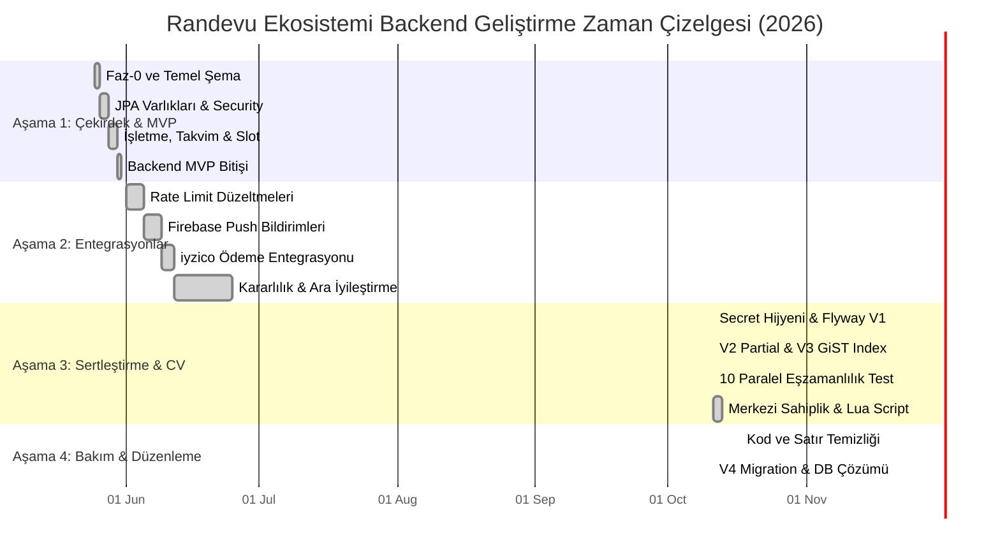

---

### 11.2. Branch Yapısı ve `main`'e Merge Edilmemiş Geliştirmeler
Depoda 2 ana dal (branch) bulunmaktadır:
- `main`: Kararlı ana branch (46. commit olan `cb1002b` seviyesinde kalmıştır).
- `fix/cv-hardening`: Aktif geliştirme dalıdır; **`main` dalının 22 commit önündedir** ve henüz `main` ile birleştirilmemiştir (unmerged).

#### `fix/cv-hardening` Dalının İçerdiği 22 Commit'in Özeti:
1. **Veritabanı Sertleştirmesi:** Flyway migration entegrasyonu, `ddl-auto: validate` zorunluluğu, V2 Partial Unique Index ve V3 GiST Exclusion Constraint.
2. **Eşzamanlılık ve Test Güvencesi:** Testcontainers PostgreSQL ile 10 paralel thread altında çift rezervasyon testleri.
3. **Merkezi Güvenlik:** `BusinessOwnershipValidator` ile tüm işletme alt kaynaklarında sahiplik doğrulaması ve `AppointmentServiceImpl` personel yetki kısıtlamaları.
4. **Redis Lua Optimizasyonları:** SlotLock atomik Lua scripti ile kilit serbest bırakma ve RateLimit interceptor'ına Lua sliding window eklenmesi.
5. **Ödeme Güvenliği:** iyzico 3DS callback idempotency kontrolü ve mükerrer istek testleri.
6. **Güvenlik Testleri:** Alt kaynaklarda 403 ve 404 dönüldüğünü doğrulayan birim güvenlik testleri.
7. **Veritabanı Düzenlemeleri:** V4 migration ile payment referans düzenlemesi.

---

## 12. Bilinen Eksikler, Açıklar ve Teknik Riskler

Yapılan statik kod analizi, test yürütmesi ve mimari inceleme sonucunda raporda belgelenmesi gereken teknik risk ve eksiklikler aşağıdadır:

### 1. V4 Migration ve JPA Entity Uyuşmazlığı (Kritik Başlatma Riski)
- **Problem:** `V4__rename_payment_provider_reference.sql` migration dosyası `payments` tablosundaki `provider_reference` kolonunu `provider_transaction_reference` olarak yeniden adlandırmıştır. Ancak `Payment.java` entity'sinde hem `providerReference` hem de `providerTransactionReference` alanları mevcuttur.
- **Sonuç:** Uygulama `ddl-auto: validate` modunda çalıştırıldığında Hibernate `missing column [provider_reference] in table [payments]` hatası fırlatmakta ve Spring `ApplicationContext` başlatılamamaktadır. Bu durum integration testlerinin çökmesine neden olmaktadır.
- **Çözüm:** Kolonu yeniden adlandırmak yerine tabloya yeni bir kolon olarak `ALTER TABLE payments ADD COLUMN provider_transaction_reference VARCHAR(255);` eklenmelidir.

### 2. SlotLock Kilit Bırakma (Release) Uyuşmazlığı (Mantıksal Hata)
- **Problem:** `SlotLockService.tryLock` rastgele bir UUID oluşturup Redis'e yazmakta, ancak `releaseLock` metodu bu rastgele UUID yerine `userId.toString()` değerini Lua scriptine göndermektedir.
- **Sonuç:** DB çakışması veya randevu iptali durumunda kilit erken kaldırılamaz; slot gereksiz yere 5 dakika boyunca kilitli kalır.
- **Çözüm:** `tryLock` içinde `userId.toString()` kilit değeri olarak kullanılmalı veya üretilen token çağırıcıya döndürülmelidir.

### 3. EXPIRED Randevu Statüsü İçin Otomasyon Eksikliği
- **Problem:** `AppointmentStatus.EXPIRED` enum değeri tanımlıdır ve veritabanı indekslerinde dikkate alınmıştır; ancak süresi dolmuş veya onaylanmadan geçmişte kalmış `PENDING` randevuları periyodik olarak `EXPIRED` durumuna çeken bir Spring `@Scheduled` görevi kod tabanında **bulunmamaktadır**.
- **Sonuç:** Onaylanmayan eski randevular sonsuza kadar `PENDING` olarak veritabanında asılı kalır.

### 4. Canlı iyzico Ödeme ve Refund Doğrulaması Eksikliği
- **Problem:** iyzico entegrasyonu Mockito birim testleri ve sandbox API parametreleriyle yazılmıştır; gerçek kartlar, 3DS banka gecikmeleri ve canlı iade (refund) akışları canlı ortamda uçtan uca test edilmemiştir.

### 5. Webhook Konfigürasyonunun Eksik Olması
- **Problem:** `N8nWebhookServiceImpl` sınıfı kodlanmış olmasına rağmen, `application.yml` dosyalarında `app.webhook.n8n-url` konfigürasyonu tanımlanmamıştır. Servis varsayılan olarak `enabled=false` durumdadır ve harici otomasyonlar tetiklenmemektedir.

### 6. SMS Entegrasyonunun Gerçek Ortamda Test Edilmemesi
- **Problem:** `NetgsmSmsService` sınıfında kullanıcı adı "demo" veya "test" olduğunda SMS göndermek yerine yalnızca log basılmaktadır. Gerçek bir Netgsm başlığı, SMS kredisi ve hatası simüle edilmemiştir.

### 7. Otomatik Test Kapsamı Raporlama (JaCoCo) Bulunmaması
- **Problem:** Derleme aracında JaCoCo tanımlanmadığı için projenin genel test kapsam oranı (code coverage) ölçülememektedir.

---

## 13. Sayısal Özet Tablosu

Projenin tüm fiziksel ve mantıksal metrikleri kaynak kodlar taranarak ve komut çıktılarıyla kesin olarak hesaplanmıştır:

| Metrik / Bileşen | Sayısal Değer | Detay / Not |
| :--- | :---: | :--- |
| **Toplam Modül / Paket Sayısı** | **16** | `com.yunus` altındaki domain paketleri |
| **Toplam Controller Sınıfı** | **21** | `@RestController` sınıfları |
| **Toplam HTTP Endpoint Sayısı** | **101** | Tüm controller metotları toplamı |
| **Toplam JPA Entity Sayısı** | **16** | `@Entity` sınıfları |
| **Toplam Enum Sayısı** | **9** | Domain enum tipleri |
| **Toplam Veritabanı Tablosu** | **18** | 16 Entity tablosu + 2 ManyToMany join tablosu |
| **Flyway Migration Dosyası** | **4** | `V1`, `V2`, `V3`, `V4` SQL migration'ları |
| **Toplam Test Sınıfı** | **14** | 12 Unit Test + 2 Integration Test |
| **Toplam Test Metodu Sayısı** | **49** | `@Test` anotasyonlu metotlar |
| **Başarıyla Geçen Test Sayısı**| **44** | Tüm birim testler (%100 başarı) |
| **Hata Alan Test Sayısı** | **5** | V4 şema uyumsuzluğu nedeniyle context hatası alan entegrasyon testleri |
| **Başarısız (Assertion Failure)** | **0** | Hiçbir test assertion hatası almamıştır |
| **Toplam Java Dosyası (Main)** | **217** | `src/main/java` altındaki sınıflar |
| **Toplam Java Dosyası (Test)** | **14** | `src/test/java` altındaki test sınıfları |
| **Genel Toplam Java Dosyası** | **231** | Projedeki toplam Java kaynak dosyaları |
| **Main Kod Satırı (Sadece Kod)**| **9,269** | `src/main/java` net kod satırları |
| **Main Yorum Satırı** | **4,508** | JavaDoc ve blok/satır içi yorumlar |
| **Main Boş Satır** | **2,118** | Okunabilirlik için bırakılan boşluklar |
| **Main Toplam Satır Sayısı** | **15,895** | `src/main/java` fiziksel satır toplamı |
| **Test Kod Satırı (Sadece Kod)**| **1,397** | `src/test/java` net kod satırları |
| **Test Yorum Satırı** | **44** | Test sınıflarındaki yorumlar |
| **Test Boş Satır** | **336** | Test sınıflarındaki boş satırlar |
| **Test Toplam Satır Sayısı** | **1,777** | `src/test/java` fiziksel satır toplamı |
| **GENEL TOPLAM SATIR SAYISI** | **17,672** | **Tüm Java kaynak dosyalarının fiziksel satır toplamı** |
| **Toplam Git Commit Sayısı** | **68** | Depo tarihindeki tüm commit'ler |
| **Aktif Branch Durumu** | `fix/cv-hardening` | `main` branch'inin 22 commit önünde |

---
*Rapor Sonu. Bu analiz belgesi proje kaynak kodları, konfigürasyonları ve veritabanı migration dosyaları taranarak hazırlanmıştır.*
